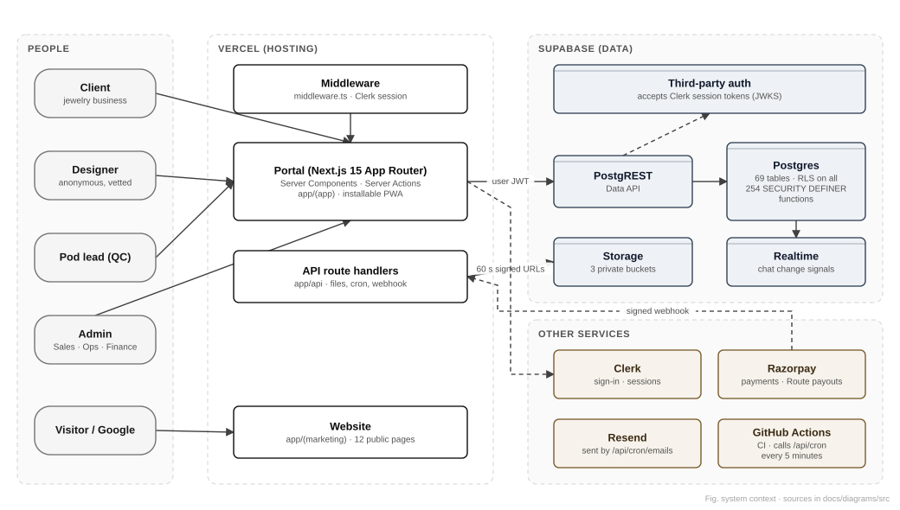
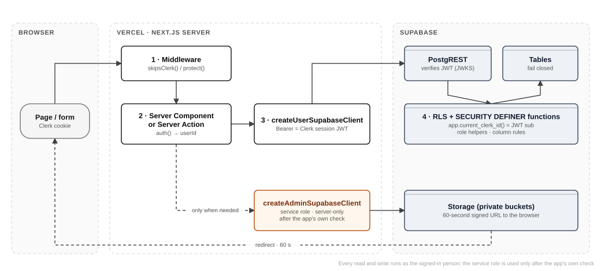

# Complete application architecture

This chapter describes how the system is put together: the layers, which way dependencies flow, where every kind of decision is made, and why. Read it before you change anything structural.

## Architectural style

The CAD Pillar is a **modular monolith with a database-centred security model**:

- **One deployable application.** The website, both portals and the API are a single Next.js 15 App Router project deployed to Vercel. There are no microservices to keep in step.
- **A pure domain core.** `core/` holds the business rules: money arithmetic, ids, state names, size charts, weight calculators, notification and email wording, support hours. A lint rule forbids it from importing React or Next.js, and breaking that rule fails CI (`.eslintrc.cjs`, `no-restricted-imports`). Rules there are tested in milliseconds and can never depend on a request.
- **The database enforces the invariants.** Postgres decides who may read and write what (RLS and SECURITY DEFINER functions), which order moves are legal (`public.order_transitions`), whether money is conserved (ledger triggers), and keeps the audit trail. The web layer gathers input and shows results; it is never the only line of defence.
- **Thin adapters around the core.** `lib/` connects to the outside world (Supabase clients, Clerk, Razorpay, Resend, web push, PDF and image generation, file sanitisation helpers). `app/` and `components/` are the delivery layer (pages, server actions, route handlers, UI).



## Repository layout

| Folder | Responsibility | Notes |
|---|---|---|
| `app/` | Routes: pages, layouts, server actions, API route handlers | Route groups: `(marketing)` website, `(auth)` sign-in, `(app)` portal; `api/` handlers; `p/[token]` public 3D preview links |
| `components/` | React components | `ui/` design-system primitives, `shell/` portal frame and navigation, `marketing/`, `domain/` (order and money widgets), `work/`, `pwa/`, `preview/` (STL viewer), `seo/` |
| `core/` | Framework-free business logic | `auth` (route protection), `money`, `orders`, `payments` (webhook signature), `files` (sanitization gate, download gate), `notifications`, `email`, `sizes`, `weights`, `time`, `support`, `ids` and more |
| `lib/` | Adapters and server utilities | `supabase/` (user client, service-role client, live client), `clerk/`, `razorpay/`, `email/`, `push/`, `files/`, `pdf/`, `certificates/`, `payouts/`, `work/`, `rateLimit.ts` |
| `config/` | Reading and validating configuration | `supabase.ts` (bucket names, signed URL lifetime), `clerk.ts`, `cron.ts`, `email.ts`, `payments.ts`, `push.ts`, `auth-redirects.ts` |
| `content/` | Public claims | `content/claims.ts`: the single list of confirmed marketing claims |
| `db/` | Database source of truth | `migrations/` (67 ordered files), `policies/` (46 RLS and grant files), `ops/` (one-off operational SQL, never applied automatically) |
| `tests/` | Tests | `db/` (RLS, functions and invariants against a throwaway Postgres), `config/`, `boundary/`, `e2e/` (Playwright journeys), `design-qa/` (screenshots and accessibility) |
| `scripts/` | Operational scripts | migrations, secret scan, payment and payout verification, email and push senders, OG image, Clerk account copy |
| `docs/` | Documentation | decisions, specs, runbooks, guides and this handbook |
| `public/` | Static files | icons, service worker (`sw.js`), Open Graph image |

## Layers and dependency direction

```text
            ┌────────────────────────────── app/ (routes) ───────────────────────────────┐
browser ──▶ │ middleware.ts → page.tsx (Server Component) / actions.ts (Server Action)    │
            │                 / route.ts (API handler)                                    │
            └──────────────┬───────────────────────────┬─────────────────────────────────┘
                           │ uses                      │ renders
                           ▼                           ▼
                 lib/ (adapters: Supabase,       components/ (UI)
                 Clerk, Razorpay, Resend…)              │
                           │                            │
                           └────────────┬───────────────┘
                                        ▼
                                core/ (pure rules)   ◀── no imports of react / next
                                        │
                                        ▼
                     Postgres (RLS · functions · triggers · audit)
```

Dependencies point inwards. `core/` imports nothing from the outer layers. `lib/` may use `core/`. `app/` and `components/` may use both. Server-only modules (`lib/supabase/admin.ts`, `lib/work/team.ts` and others) import `server-only`, so the build fails if one is ever pulled into browser code.

## Runtime topology

| Runtime | What runs there | Notes |
|---|---|---|
| Browser | React client components, the installable PWA shell (`public/sw.js`), the STL 3D viewer (three.js), the Clerk sign-in widgets | Holds only the Clerk session cookie and public keys (`NEXT_PUBLIC_*`) |
| Vercel edge | `middleware.ts` | Decides whether Clerk's middleware runs (`skipsClerk`), and protects portal paths (`isProtectedPath`) |
| Vercel serverless functions (Node.js) | Server Components, Server Actions, API route handlers | Region is set next to the database for speed (see `docs/PERFORMANCE.md`) |
| Supabase | Postgres 15+, PostgREST (Data API), Storage, Realtime, optionally pg_cron | The only stateful component |
| Third parties | Clerk, Razorpay, Resend, push services, GitHub Actions | See chapter 11 |

## How a request flows



1. **Middleware** (`middleware.ts`, rules in `core/auth/session.ts`). For a GET or HEAD of a public website page, or of a path that is not an app route at all, Clerk is skipped. That gives search engines a clean 200 or 404 and no redirect. Everything under an app segment (`APP_ROUTE_SEGMENTS`) goes through Clerk, and paths in `PROTECTED_PREFIXES` require a signed-in user. A test walks `app/` and fails if a route sits under a segment the middleware does not know (`tests/config/route-inventory.test.ts`).
2. **Server Component or Server Action.** It reads the user with Clerk's `auth()`. Pages that are only for the team call `requireTeam`, `requireAdmin` or `requireFinance`. These are convenience gates; the real check is in step 4.
3. **The user-scoped Supabase client** (`lib/supabase/server.ts`, `createUserSupabaseClient`) attaches the person's Clerk session token as `Authorization: Bearer …`. It uses the public anon key, never the service role, so every query runs with exactly that person's rights.
4. **Postgres** verifies the token (third-party auth, Clerk's JWKS). `app.current_clerk_id()` returns its `sub`, and RLS policies and SECURITY DEFINER functions allow or refuse each row.
5. **The service role is used only when needed, and only after the caller's access has been proven in step 4.** Typical cases are writing a sanitised file to a private bucket, or minting a 60-second signed download link (`lib/supabase/admin.ts`). Chapter 9 lists every file that does this.

## Where decisions are made

| Decision | Made in | Enforced in |
|---|---|---|
| Is this person signed in? | Clerk (session) | Middleware and handlers (`auth()`) |
| What role does this person have? | `users.role`, `user_roles` (database) | `app.current_user_role()`, `app.has_role()`, `app.is_admin()` |
| Can they see this order, file or message? | RLS policies and visibility functions such as `visible_orders()` and `can_read_thread()` | Postgres |
| Is this order move legal, and by whom? | `public.order_transitions` (23 rows: from, to, role) | Transition functions |
| Is money conserved? | Ledger rules | `escrow_ledger` triggers (`app.enforce_escrow_conservation`) |
| Is this file acceptable? | `core/files/sanitizationGate.ts` (type, magic bytes, metadata) | Upload actions |
| May this file be downloaded now? | `core/files/downloadGate.ts` plus RLS | `lib/files/access.ts` |
| What does the client pay, and what does the designer earn? | `core/money`, quote functions, admin settings | Money columns are read only through functions that show them by role (policies 0048) |

## Key architectural decisions (and why)

| Decision | Reason | Trade-off |
|---|---|---|
| Authorisation in Postgres (RLS and functions), not in the API layer | One place that every path must pass; a forgotten table fails closed; tests can prove it | Business logic split between SQL and TypeScript; needs SQL skills |
| Clerk for identity, Supabase for data, joined by third-party auth | Best-in-class sign-in UX with no passwords stored by us; database sees a verified `sub` | Two vendors; Clerk user ids are the primary key of `users` (see the Clerk production switch in `docs/CLERK-PRODUCTION.md`) |
| Opaque ids and separate identity tables | Makes anonymity structural rather than a matter of discipline | Admin screens must call identity functions, and those reads are logged |
| Append-only audit log and escrow ledger | Disputes, payouts and compliance need trustworthy history | Corrections are new rows, never edits |
| Monolith on serverless | Fast iteration for a small team; one deploy | Long jobs need care (timeouts); the scheduler is external |
| Scheduled work driven by GitHub Actions every 5 minutes | Vercel Hobby allows a cron only once a day | Best-effort timing; moving to Vercel Pro restores `vercel.json` crons |
| Files stored privately, downloaded via 60-second signed links | IP protection; links cannot be passed around | Each download costs one server round trip |

## Cross-cutting concerns

- **Configuration:** read and validated in `config/`. `/api/health` reports which groups are configured, without revealing values.
- **Errors:** user-facing errors are friendly (`core/errors`, `lib/refusal.ts`). Database refusals are translated, never shown raw to clients.
- **Time:** stored in UTC and shown in the viewer's time zone (a device cookie; `core/time`). The live-support hours are computed in US Eastern time with daylight saving (`core/support`).
- **Money:** integers only, cents for USD and paise for INR (`core/money`, `lib/money.ts`).
- **Accessibility and design:** tokens in `app/globals.css`, components in `components/ui`. Axe checks run in the design-QA workflow.
- **Performance budgets:** `docs/PERFORMANCE.md`, measured by `tests/e2e/zz-speed.e2e.ts`. Lighthouse runs in CI.
