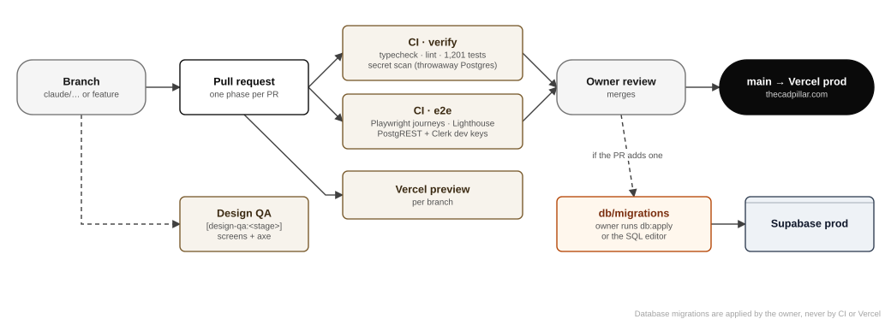

# Infrastructure, GitHub, Vercel and deployment workflows

This chapter maps every piece of infrastructure, who owns it, how code travels from a branch to production, and how the database is changed. Settings marked *(verify)* could not be confirmed from the repository; they are listed in the assumptions chapter.

## Infrastructure map

| Component | Provider | Identifier | Notes |
|---|---|---|---|
| Domain registration | GoDaddy | `thecadpillar.com` | Nameservers point to Vercel |
| DNS | Vercel DNS | `ns1.vercel-dns.com`, `ns2.vercel-dns.com` | Records live under Vercel → Team → Domains → `thecadpillar.com` → DNS Records |
| Web hosting | Vercel | Team project **`tcp`** (`tcp-gamma.vercel.app`); `www` → 308 → apex | Plan: Hobby *(see SEC-08)*. An older, unused project also exists *(see SEC-03)*. |
| Function region | Vercel | Should be next to the database: Cleveland `cle1` for a Supabase project in Ohio `us-east-2` (`docs/DEPLOY.md` §2b) *(verify)* | Each database round trip costs about 2 ms when co-located, about 200 ms when not |
| Database, storage, realtime | Supabase | Production project in the organisation "The CAD Pillar" | Plan: Free at audit *(see SEC-02)*; `pg_cron` *(verify, SEC-14)* |
| Identity | Clerk | Production instance on `clerk.thecadpillar.com`; development instance for CI | Google sign-in with company OAuth credentials (Google Cloud project "The CAD Pillar") |
| Payments | Razorpay | Checkout + Route (payouts) | Webhook → `/api/webhooks/razorpay`. Payments are on hold until approved. |
| Email (transactional) | Resend | `RESEND_API_KEY`, `EMAIL_FROM` | Delivery gated by `EMAIL_DELIVERY` *(see SEC-07)* |
| Email (people) | Google Workspace | MX `smtp.google.com` | `simran@thecadpillar.com` |
| Push | Web Push (VAPID) | `NEXT_PUBLIC_VAPID_PUBLIC_KEY`, `VAPID_PRIVATE_KEY`, `VAPID_SUBJECT` | Browser push services |
| Source code and CI | GitHub | `simran313/GetCAD` | Actions: `ci.yml`, `design-qa.yml`, `push-dispatch.yml` |
| Search | Google Search Console | Property for `thecadpillar.com` | `NEXT_PUBLIC_GOOGLE_SITE_VERIFICATION` |

## Environments

| Environment | Where | Clerk | Database | Who uses it |
|---|---|---|---|---|
| Local development | A developer machine or Codespace | Development keys | A local Postgres for tests; the developer's chosen Supabase project for the running app | Developers |
| CI | GitHub Actions | Development keys (test users with `+clerk_test`) | Throwaway Postgres service container, plus PostgREST for e2e | Automated |
| Preview | Vercel, per branch | Development keys | *(verify: should not be production; SEC-08)* | Reviewers |
| Production | Vercel `tcp` on `thecadpillar.com` | Production keys | Supabase production | Everyone |

Configuration variables are listed by name in [Appendix E](./generated/environment.md). Values live only in Vercel (by environment), GitHub Actions secrets (`APP_URL` and `CRON_SECRET` for the dispatcher; Clerk development keys for e2e) and developers' untracked `.env.local`.

## GitHub

- **Default branch:** `main`, deployed automatically to production by Vercel.
- **Working branches:** `claude/…` for AI-assisted work, plus feature branches. One phase per pull request (`CLAUDE.md`).
- **Pull requests:** CI must be green; the owner reviews and merges. Branch protection rules *(verify)*: recommended are required status checks (`verify`, `e2e`), no force pushes to `main`, and at least one approval.
- **Secrets in the repository:** none (verified). `.env.example` documents names only. `npm run secret-scan` runs in CI.

### Workflows

| Workflow | Trigger | What it does |
|---|---|---|
| `.github/workflows/ci.yml` → job `verify` | Every pull request; pushes to `main` | `npm ci`, type-check (strict), lint (including the `core/` boundary), vitest (1,201 tests against a Postgres 16 service container), secret scan. Target: under 5 minutes. |
| `ci.yml` → job `e2e` | Same | Prepares a database and Clerk test users, starts PostgREST, builds the app against the test stack and runs the Playwright journeys (17 suites, including the anonymity crawl, money, files, live chat, iPhone layout and speed). Then Lighthouse on home and pricing (mobile), uploading the report. |
| `.github/workflows/design-qa.yml` | A push to `design/redesign` or `claude/gracious-hopper-amum18` whose commit message has `[design-qa:<stage>]`; manual dispatch | Screenshots every route at several sizes and runs axe. `[design-qa:after]` fails on any serious accessibility finding. Results go to the `design-qa` branch. |
| `.github/workflows/push-dispatch.yml` | Every 5 minutes (cron) and manual | Calls `/api/cron/push` and `/api/cron/emails` with the `CRON_SECRET` bearer token. It exists because Vercel Hobby crons run at most once a day. |

## Delivery pipeline



1. **Branch** from `main`. Make the change, with tests.
2. **Run locally:** `npm run ci` (type-check, lint, tests, secret scan), or `npm run test:local` to start the throwaway Postgres first.
3. **Open a pull request.** CI (`verify`, `e2e`) and a Vercel preview start automatically.
4. **Review.** The owner reviews the diff, the preview and CI, then merges.
5. **Deploy.** Vercel builds `main` and promotes it to `thecadpillar.com` (zero downtime; the previous deployment stays available).
6. **Database migration**, if the pull request adds one. The owner applies it deliberately, before or after the deploy as the pull request states:

   ```bash
   # from a trusted machine, with DATABASE_URL pointing at production
   npm run db:status          # what is pending (changes nothing)
   npm run db:apply           # applies pending files in order, recording each
   ```

   Or paste the file into the Supabase SQL editor. Never point `npm test` or `npm run ci` at production: the harness drops schemas and refuses non-local hosts for that reason.
7. **Verify:** `/api/health` shows every group true; a quick role walkthrough (chapter 16); Vercel → Logs filtered to errors.

### Rollback

| What | How | Time |
|---|---|---|
| Application | Vercel → Deployments → last good deployment → **Promote to Production** | Seconds |
| Configuration change | Revert the variable in Vercel, then redeploy | Minutes |
| Database migration | Forward-only: write a new migration that undoes the change, tested locally. For data loss, restore from backup (chapter 14). | Depends |
| Clerk switch | Documented in `docs/CLERK-PRODUCTION.md` ("If something is wrong") | Minutes |

## Domains and DNS records (Vercel DNS)

| Name | Type | Purpose |
|---|---|---|
| `@` | A (Vercel) | Website |
| `www` | CNAME / redirect | 308 to the apex |
| `@` | MX `smtp.google.com` | Google Workspace mail |
| `@` | TXT `v=spf1 include:_spf.google.com ~all` | SPF (Google only) |
| `@` | TXT `google-site-verification=…` | Search Console |
| `@` | TXT `v=DKIM1 …` | **Misplaced** DKIM key; should be at `google._domainkey` (SEC-07) |
| `clerk` | CNAME `frontend-api.clerk.services` | Clerk Frontend API |
| `accounts` | CNAME `accounts.clerk.services` | Clerk account portal |
| `clkmail` | CNAME `mail.<id>.clerk.services` | Clerk email sending |
| `clk._domainkey`, `clk2._domainkey` | CNAME `dkim1/2.<id>.clerk.services` | Clerk email DKIM |
| `_dmarc` | *(missing)* | Add a DMARC policy (SEC-07) |

## Observability

| Signal | Where |
|---|---|
| Application errors and logs | Vercel → Project `tcp` → Logs (filter Level: Error); Runtime Logs per deployment |
| Configuration health | `GET https://thecadpillar.com/api/health` |
| Database health, slow queries, storage use | Supabase dashboard (Reports, Logs, Storage) |
| Scheduled jobs | GitHub → Actions → "push-dispatch" run history; the `/api/cron/*` responses carry counts |
| Payments and payouts | Razorpay dashboard (webhook delivery logs); `npm run verify:payment`, `verify:payout`, `verify:delivery` |
| Email delivery | Resend dashboard; `email_outbox` rows (status, attempts) |
| Audit integrity | `SELECT audit.verify_chain();` in the SQL editor |
| Performance | Lighthouse report artefact in CI; `docs/PERFORMANCE.md`; Vercel Speed Insights *(if enabled)* |

There is no external uptime monitor or error-tracking service at audit time. Adding one is in the roadmap (chapter 15).
