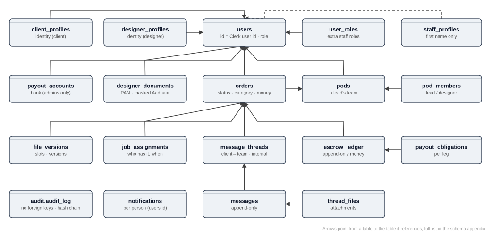
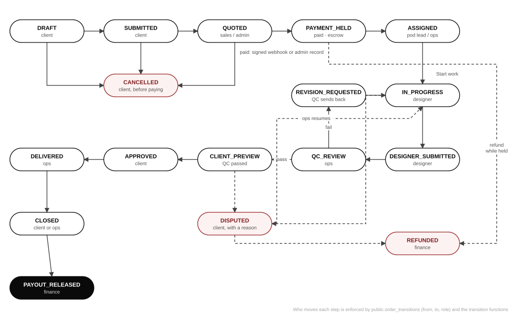

# Database schema, relationships and row-level security

The database is the heart of the platform and its security boundary. This chapter explains how it is organised, how the tables relate, how row-level security (RLS) and privileged functions work together, and how to change the schema safely. The exhaustive, machine-generated listing of every table, column, constraint, policy, trigger and function is in [Appendix A](./generated/schema.md) and [Appendix B](./generated/functions.md).

## Schemas

| Schema | Purpose | Reachable by signed-in users? |
|---|---|---|
| `public` | Business tables and the functions the application calls (through PostgREST, the Data API) | Yes, subject to RLS and grants |
| `app` | Internal helpers: identity (`current_clerk_id`, `current_user_role`, `has_role`, `is_admin`, `is_staff`), visibility (`can_read_thread`, `order_in_my_pods`, `is_assigned_designer`), triggers, notification and email queueing | Used *inside* policies and functions. It must not be exposed through the Data API (see SEC-06). |
| `audit` | The hash-chained audit log, and the functions that append to it and verify it | No direct access. `anon` and `authenticated` have no usage on the schema. |

## Table inventory (69 tables)

| Domain | Tables |
|---|---|
| Identity and access | `users`, `user_roles`, `client_profiles`, `designer_profiles`, `staff_profiles`, `client_accounts`, `client_managers`, `pods`, `pod_members`, `designer_rates` |
| Designer onboarding and compliance | `designer_applications`, `agreement_documents`, `agreement_acceptances`, `designer_documents`, `payout_accounts` |
| Orders and briefs | `orders`, `order_transitions`, `order_specs`, `order_spec_accents`, `order_reference_images`, `order_reference_pins`, `order_screenshots`, `order_stone_certificates`, `client_master_instructions`, `job_categories`, `price_bands` |
| Work and QC | `job_assignments`, `job_pauses`, `job_alerts`, `job_escalations`, `job_volumes`, `job_weights`, `checklist_items`, `order_checks`, `qc_measurements`, `revision_requests`, `pod_materials` |
| Files and deliverables | `file_versions`, `deliverables`, `deliverable_slots`, `deliverable_files`, `certificates`, `preview_links`, `spec_claims`, `spec_waivers` |
| Messaging | `message_threads`, `thread_participants`, `messages`, `thread_files`, `thread_reads` |
| Money | `payment_intents`, `escrow_ledger`, `payout_obligations`, `payouts`, `client_credits`, `disputes`, `sla_events` |
| Notifications and email | `notifications`, `push_subscriptions`, `email_outbox`, `email_preferences` |
| Marketing and website | `marketing_leads`, `marketing_events`, `marketing_attribution`, `public_stats`, `rate_limit_events` |
| Configuration | `app_settings`, `feature_flags` |
| Audit | `audit.audit_log` |



## Keys and identity

- **`users.id` is the Clerk user id** (for example `user_3Hd…`). It is the `sub` claim of the session token, so `app.current_clerk_id()` can match rows directly. That is why the move from Clerk development to production required re-keying every reference (`db/ops/clerk-id-remap.sql`, `docs/CLERK-PRODUCTION.md`).
- **Business ids are opaque.** Orders and most rows use random ids generated by nanoid (`core/ids`) or `gen_random_uuid()`, never sequences, so ids cannot be guessed or counted. Human-facing references (job codes such as `RN-C-1001`, client reference codes) are separate columns.
- **Identity is separated from activity.** Names, emails, companies, bank details and documents sit only in `client_profiles`, `designer_profiles`, `payout_accounts` and `designer_documents`. Orders, threads and files carry only ids and role labels.
- **Roles.** `users.role` holds the primary role. Staff can hold extra roles in `user_roles`. Enum `role`: `CLIENT`, `DESIGNER`, `QC`, `SALES`, `OPS`, `FINANCE`, `ADMIN`, `SUPER_ADMIN`. An "admin" in the business sense holds Sales, Ops and Finance (`app.is_admin()`). A pod lead is a `QC` user who leads a pod (`pod_members.member_role = 'POD_LEAD'`).

## Row-level security: how it is applied

**Every one of the 69 tables has RLS enabled.** The model has three layers.

1. **Deny by default.** With RLS on and no policy for a role, the table returns nothing and accepts nothing. Many sensitive tables deliberately have *no* policy for `anon` or `authenticated`. They can only be reached through SECURITY DEFINER functions that check the caller (Appendix A shows "Policies: none").
2. **Policies for simple, direct reads and writes.** Forty-three policies cover cases such as "a person reads their own notifications" and "a client reads their own orders". Policies call helpers in `app` (for example `app.current_clerk_id()`, `app.can_read_thread(id)`, `app.order_in_my_pods(id)`).
3. **SECURITY DEFINER functions for everything else.** There are 254. Each runs with its owner's rights, checks the caller explicitly (raising `not authenticated`, `only the client who owns an order may …`, and so on) and pins `search_path` (all 254 do), so a caller cannot trick it with a look-alike table. Examples: `visible_orders()` (an order with the money columns shown by role), `confirm_order()`, `assign_designer()`, `qc_decide()`, `designer_document_open()` (admins only, and writes an audit row), `payout_account_full()` (admins only, logged).

**Column-level rules.** Some columns are hidden from roles that may see the row. The order's price and payments are read only through functions that show them by who is asking, so pod leads and designers never see what the client paid (policies `0048_money_visibility_rls.sql`, migration `0065_money_visibility_rates.sql`).

### Policy examples

The precise text of every policy is in Appendix A. Typical shapes:

```sql
-- A person reads only their own notifications. (db/policies)
CREATE POLICY notifications_read_own ON public.notifications
  FOR SELECT TO authenticated
  USING (user_id = app.current_clerk_id());

-- Thread messages are readable only by people the thread admits.
CREATE POLICY messages_read ON public.messages
  FOR SELECT TO authenticated
  USING (app.can_read_thread(thread_id));
```

These two are the exact policies in production (names and expressions as read from the database built from `db/policies/`). The `orders` table shows how several narrow policies combine; a row is visible if *any* of them allows it:

| Policy on `orders` | Who it admits |
|---|---|
| `orders_client_select` | The client who owns the order (`client_id = app.current_clerk_id()`) |
| `orders_pod_lead_select` | A pod lead, for orders in their pods (`pod_id = ANY (app.current_pod_ids())`) |
| `orders_qc_reviewer_select` | The QC reviewer recorded on the order |
| `orders_staff_select` | Staff whose role may act on the order's current status (`order_transitions`, staff scope, excluding QC) |
| `orders_admin_select` | Admins (`app.is_admin()`) |

Designers read their jobs through functions such as `my_work()`, never through `orders` directly, so a designer cannot see the client's columns.

## Invariants enforced by the database

| Invariant | Mechanism | Source |
|---|---|---|
| Only legal order moves, by the right role | `order_transitions` table (23 rows) checked by the transition functions | `0035_order_model.sql` and later |
| A client cannot fund their own order | Funding only through `confirm_payment` (the signed webhook path) or an admin recording a manual payment | Payment migrations, `app/api/webhooks/razorpay` |
| Quote parts sum to the total | CHECK and function validation | Quote migrations (`0040_quote_sla.sql`) |
| Money is conserved per order | Trigger `app.enforce_escrow_conservation` on `escrow_ledger` | Escrow migrations |
| Ledger, messages, agreement acceptances and certificates are immutable | `BEFORE UPDATE OR DELETE` triggers that raise | e.g. `messages_no_update`, `escrow_ledger_no_delete`, `certificates_immutable` |
| Audit history cannot be rewritten | Append-only triggers plus a hash chain (`audit.verify_chain()`) | `0006_audit_log.sql` |
| A reviewer cannot pass their own work | Check inside `qc_decide` | QC migrations |
| Work only goes to vetted designers | `app.designer_is_assignable()` (active, with the current agreement signed) | `0009_designer_onboarding_gate.sql` |
| A payout is paid once | Unique constraint per obligation, plus idempotency keys | Payout migrations |

## The order state machine



`public.order_transitions` lists every legal move with the role that may make it:

| From | To | Actor role |
|---|---|---|
| DRAFT | SUBMITTED, CANCELLED | CLIENT |
| SUBMITTED | QUOTED | SALES |
| SUBMITTED | CANCELLED | CLIENT |
| QUOTED | PAYMENT_HELD, CANCELLED | CLIENT (payment is confirmed by the signed webhook or an admin) |
| PAYMENT_HELD | ASSIGNED | OPS |
| PAYMENT_HELD | REFUNDED | FINANCE |
| ASSIGNED | IN_PROGRESS | DESIGNER |
| IN_PROGRESS | DESIGNER_SUBMITTED | DESIGNER |
| IN_PROGRESS | DISPUTED | CLIENT |
| DESIGNER_SUBMITTED | QC_REVIEW | OPS |
| QC_REVIEW | REVISION_REQUESTED, CLIENT_PREVIEW | QC |
| REVISION_REQUESTED | IN_PROGRESS | DESIGNER |
| CLIENT_PREVIEW | APPROVED, DISPUTED | CLIENT |
| APPROVED | DELIVERED | OPS |
| DELIVERED | CLOSED | CLIENT or OPS |
| CLOSED | PAYOUT_RELEASED | FINANCE |
| DISPUTED | IN_PROGRESS | OPS |
| DISPUTED | REFUNDED | FINANCE |

Later decisions layered business steps on top of these states without adding states:
- the admin confirms the order and chooses its pod (DECISIONS §11), and the pod lead assigns;
- reassignment and withdrawal of a job (`reassign_job`, migration `0066_one_designer_withdraw.sql`);
- the SLA clock, which starts when an order is both paid and confirmed.

## Triggers you should know

| Trigger family | What it does |
|---|---|
| `orders_*` (11 triggers) | Assign references, route to the only pod, create threads, start the first-look clock, gate on specs and weights, reprice on assignment, close pauses, queue client emails and marketing events, open payouts on close |
| `audit_log_chain`, `audit_log_fanout` | Compute each entry's hash; fan entries out to notifications |
| `*_no_update`, `*_no_delete`, `certificates_immutable` | Make history tables append-only |
| `escrow_ledger_conservation`, `escrow_ledger_hold_paid` | Keep money conserved and mark orders paid |
| `messages_signal_thread`, `thread_files_signal_thread`, `thread_reads_signal_thread` | Send the "thread changed" Realtime signal |

## Changing the schema safely

1. **Write a new file.** Never edit an applied migration. Name it with the next number, for example `db/migrations/0067_short_name.sql`. Put RLS policies and grants for new tables in `db/policies/` (also numbered).
2. **New table checklist:** `ALTER TABLE … ENABLE ROW LEVEL SECURITY`; policies for exactly the roles that need direct access, or none if access is only through functions; no grant to `anon` unless the table is public by design; opaque ids; integer money; an audit write for every meaningful change.
3. **New SECURITY DEFINER function checklist:** `SET search_path = ''` and schema-qualified names; check `app.current_clerk_id()` and the role first; refuse with a clear message; `REVOKE EXECUTE … FROM PUBLIC, anon` and `GRANT` only to the roles that call it; append to the audit log.
4. **Test it** with `npm run test:local` (throwaway Postgres on `127.0.0.1:5433`). Add a test in `tests/db/` that proves both the allowed and the refused paths.
5. **Apply in production deliberately.** The owner runs `npm run db:apply` with `DATABASE_URL` pointing at production, or pastes the file into the Supabase SQL editor. `scripts/apply-migrations.mjs` records applied files in `public.schema_migrations`, and `--status` shows what is pending. CI and Vercel never touch the production database. The test harness refuses any non-local database (`tests/helpers/db.ts`, `assertDestroyable`), because a production database was once dropped by a test run in a shell where `DATABASE_URL` was still set.
6. **One-off operational SQL** (data fixes, account moves) goes in `db/ops/` with a dry-run mode. It is never applied automatically.

## Regenerating the reference appendices

```bash
npm run test:db:up        # or any local Postgres on 127.0.0.1:5433
DATABASE_URL=postgres://postgres@127.0.0.1:5433/postgres \
  node docs/document-generation/extract-reference.mjs
```

The script builds a scratch database from `db/migrations` and `db/policies`, reads the catalogue, writes Appendices A to E, and drops the scratch database. It refuses any host that is not local.
