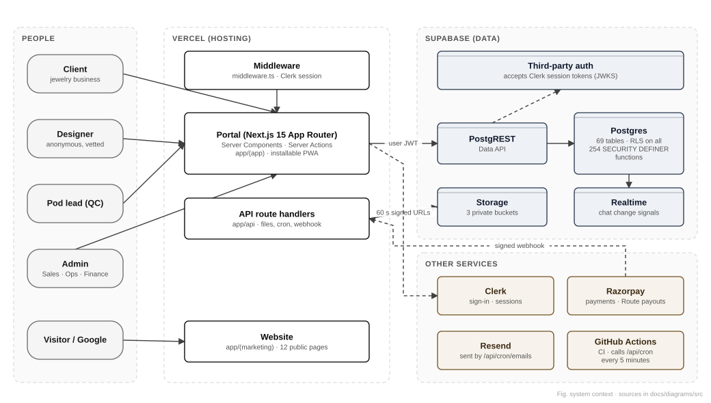
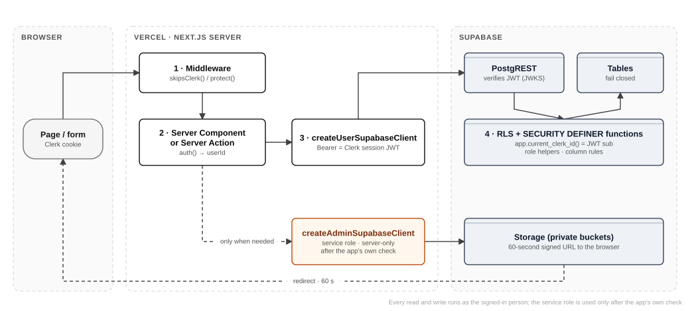
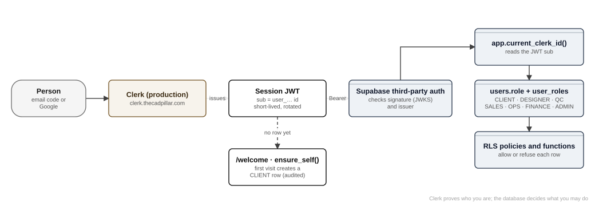
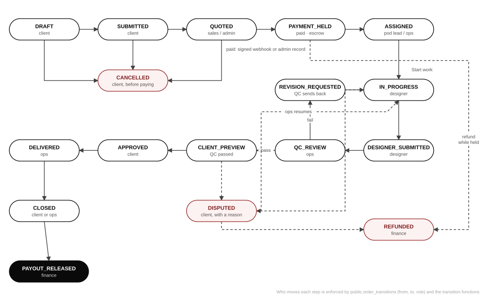
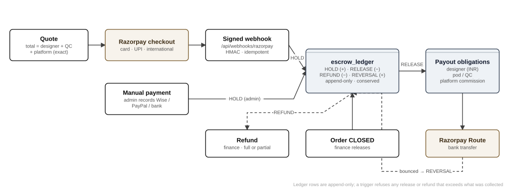
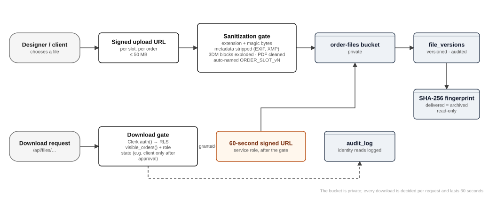
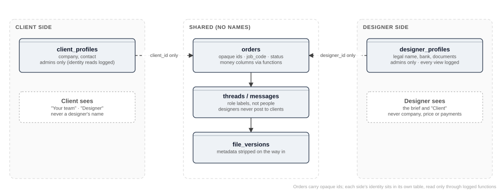
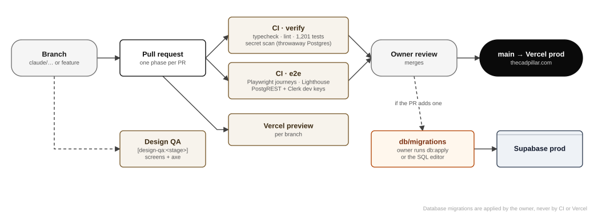
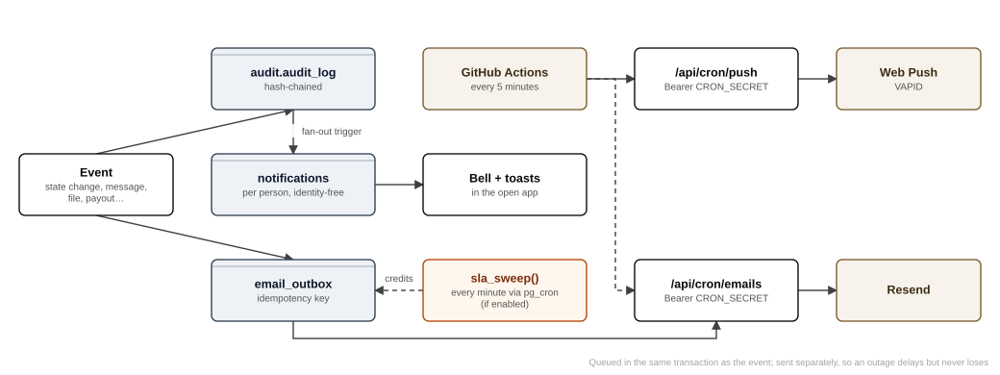
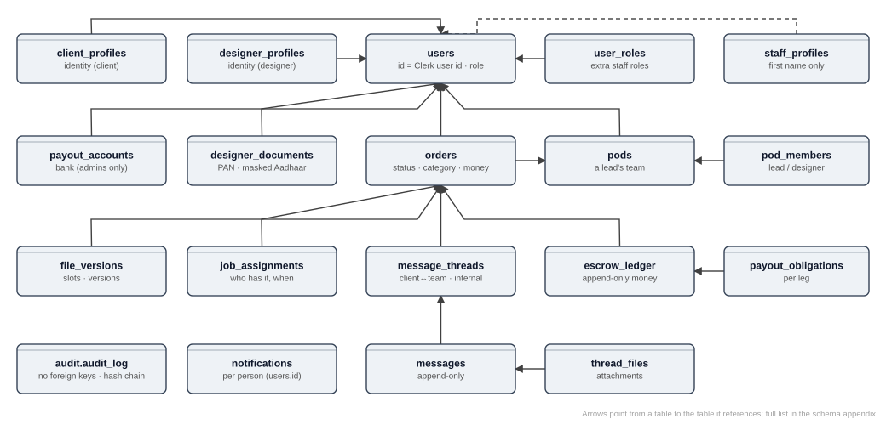

# Architecture and workflow diagrams

All diagrams in one place, for printing or presenting. Each is generated from an editable source in `docs/diagrams/src/` by `node docs/document-generation/diagrams.mjs`. The source is data (boxes, groups and arrows with coordinates), so a diagram can be changed with a text editor and re-rendered. SVG files are used by the Markdown and the PDF; 2× PNG files (`docs/diagrams/png/`) are used by the Word document.

## System context

Who uses the platform and which services it depends on.

## Request flow and trust boundaries

How a signed-in request reaches the data, and where each check happens.

## Authentication and identity bridge

From sign-in to a database row.

## Order state machine

The 17 states and the legal moves between them.

## Money flow and escrow

Where the money is at every step.

## File pipeline and IP protection

How CAD files are cleaned, stored and released.

## Anonymity wall

How client and designer identities are kept apart.

## Delivery pipeline

From a code change to production.

## Notifications, push and email

What runs on its own.

## Core data model

The central tables and their relationships.

