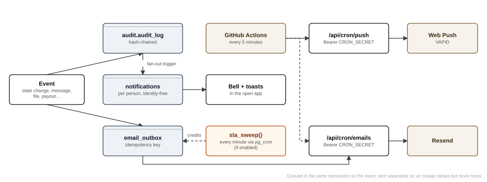
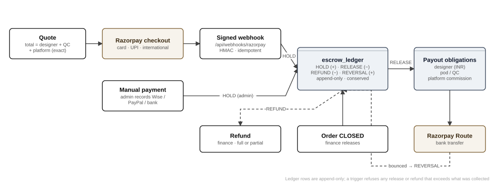

# Feature-by-feature technical reference

Each feature below is described the same way: **what it does**, **who uses it**, **where it lives** (routes, code, tables, database functions), and **the rules the system enforces**. Business rules come from `docs/DECISIONS.md` (version 1.28), which wins over any other document. Section numbers such as §11 refer to it.

## Public website and lead capture

- **What:** the marketing site (home, jewelry CAD services, how it works, pricing "from $35", guarantee, quality, FAQ, contact, apply as a designer, privacy, terms, results), with structured data for search engines and a social sharing image.
- **Where:** `app/(marketing)/*`, `components/marketing/*`, `content/claims.ts` (confirmed claims only), `lib/seo.ts`, `app/sitemap.ts`, `app/robots.ts`; `docs/SEO.md`.
- **Data:** `marketing_leads` (contact and brief leads), `marketing_events`, `marketing_attribution` (first-touch cookie), `designer_applications`, `public_stats` (`/results`, hidden until 30 days of data, §12).
- **Rules:** forms are rate-limited per network address, stored only as a salted hash (`check_rate_limit`, `RATE_LIMIT_SALT`). Claims must be in `content/claims.ts`. A route-inventory test keeps the public URL list fixed.

## Accounts and onboarding

- **Clients:** self sign-up → `/welcome` → `ensure_self()` creates a CLIENT row (audited). Or the team registers a client while placing an order on their behalf (`register_client`).
- **Designers:** apply publicly (lead, no account) → reviewed at `/admin/applications` → added by an admin on Admin → Designers (`register_designer`) → sign in with an emailed code → apply in-app (`apply_as_designer`) → sign the agreement (`accept_designer_agreement`; stores the SHA-256 of the exact text shown; a new version re-gates everyone) → status ACTIVE → payout details at `/settings/payouts` (`upsert_payout_account`).
- **Staff and pod leads:** an admin grants roles on Admin → Access (`set_user_role`). Making someone a pod lead creates their pod (`create_pod`).
- **Tables:** `users`, `user_roles`, `client_profiles`, `designer_profiles`, `staff_profiles`, `agreement_documents`, `agreement_acceptances` (immutable), `payout_accounts`, `designer_documents`.

## Ordering and the CAD brief

- **What:** a client creates an order and writes a three-step brief (§11).
  1. **The piece:** name, type and at least one photo.
  2. **Stones:** centre stone yes or no; if yes, shape, size and setting; side stones optional.
  3. **Size and metal:** country and ring size (about 40 countries), metal and karat, notes.
- **Extras:** reference images with numbered pins and drawings; drafts and "start from a past order"; master instructions (a client's standing factory rules, shown on every order to the designer, pod lead and admins); certified centre-stone certificates (up to 5; PDFs cleaned to pages only).
- **Ring sizes:** inside diameter and circumference come from the chosen country's chart (`core/sizes`). The client may enter their own measurement instead; designers and pod leads see both and where the measurement came from (1.26).
- **Where:** `/orders/new`, `/orders/[id]/brief`, `/orders/[id]/brief/review`; `app/(app)/orders/[id]/brief/*`; `lib/client/standingActions.ts`.
- **Data:** `orders`, `order_specs`, `order_spec_accents`, `order_reference_images`, `order_reference_pins`, `order_stone_certificates`, `client_master_instructions`.
- **Rules:** no step moves on without its required answers (1.22). The brief is fixed once quoted (functions refuse with "the brief is fixed once the order has been quoted"). Only the owning client may write it.

## Orders placed on a client's behalf

- **What:** the team turns a WhatsApp, email or phone request into an order, with at least one screenshot (§11).
- **Where:** `/admin/new-order`; `create_order_on_behalf`, `add_order_screenshot`, `submit_order_on_behalf`; the client receives the ORDER_PLACED_FOR_YOU email; table `order_screenshots`.

## Categories, quotes and prices

- **Categories A–L** (minutes 15 to 480; Standard A–F, Complex G–L; `job_categories`).
- **Client bands** (internal defaults, `price_bands`, `app.band_price`): Standard A–C $35; Complex D–F $85; Sculpted G–L from $120, quoted; the first design for a new account is $35. The website shows one price, "from $35" (§4).
- **Quote:** an admin sets the price. The system splits it into designer pay, pod/QC pay and platform commission. The parts must sum exactly, and the system warns above a 40% payout share (§4).
- **Designer pay (1.25):** category minutes × the designer's rate (standard ₹8 a minute; an admin may set one designer's own rate in `designer_rates`). Repriced to the assigned designer's rate on assignment (trigger `orders_reprice_on_assign`).
- **Pod pay:** 50% of the designer's pay, at least ₹300 (admin settings).
- **Visibility:** pod leads and designers never see the client's price or payments. Money columns are read through role-aware functions (policies 0048).

## Payments

- **Card and UPI:** `/orders/[id]/pay` → `open_payment_intent` → the Razorpay widget → the signed webhook → `confirm_payment` → ledger HOLD → order paid (`payment_intents`, `escrow_ledger`).
- **Manual:** an admin records a Wise, PayPal or bank payment (`mark_payment_received`).
- **Rule:** a client can never mark their own order paid (§7.1).

## Confirmation, pod routing and assignment

- **Confirm (§6, §11):** an admin or the pod lead presses "Confirm order" once the brief is complete (`confirm_order`). **The SLA clock starts when the order is both paid and confirmed**, whichever happens last.
- **Pod routing:** if exactly one pod has a lead, a paid or confirmed order joins it automatically (`orders_auto_pod`). Otherwise the admin chooses.
- **Assignment (1.28):** the pod lead assigns one designer from their pod (`assign_designer`). After that the job is moved (`reassign_job`, with a reason once work has started) or taken back, never assigned again on top. An admin assigning directly is a folded exception.
- **Capacity:** 480 category-minutes per designer per shift; a warning in v1, blocking behind the `capacity_blocking` flag.
- **Data:** `job_assignments`, `pods`, `pod_members`; trigger `orders_assign_ref`.

## Designer workspace

- **Where:** `/work`, `/work/[id]`, `/work/[id]/checklist`, `/work/[id]/review`, `/work/earnings`; `app/(app)/work/*`, `components/work/*`.
- **Clock:** "Start work" starts the category clock. Pause and resume are recorded (`job_pauses`); the designer's own clock stops while paused, but the due time to QC never moves (1.6). Alerts fire an hour before due and once overdue (`job_alerts`).
- **Uploads:** slots 3DM, STL, RENDER and TECH; direct signed upload up to 50 MB; 3DM blocks exploded; metadata stripped (chapter 8).
- **Render composer:** four equal cells; paste or drag images, swap by dragging, × to remove; composed server-side into one RENDER image.
- **Weights:** the designer saves the 18K cast weight (with allowances) and the diamonds (`job_weights`, `job_volumes`). The server joins a panel under the technical image (`lib/files/techSheet.tsx`). A CAD version cannot be submitted without the gold weight (`weights_gate`).
- **Designer check:** 9 lines, all must pass (`checklist_items`, `order_checks`, `mark_check`).
- **Final review:** full screen with the references and brief, the model (STL in 3D), and the checks; "Send to QC" unlocks when the last line passes.

## Quality control

- **Two stages (§10):** the designer's 9-line check, then the QC manager's 5-line check (the pod lead, never the designer). Each line is Pass or Fail, with a finding and remark.
- **Decision:** `qc_decide` passes the work (CLIENT_PREVIEW) or sends it back (REVISION_REQUESTED). Sending back needs a failed line or a note, and the failed lines become the revision note. Measurements are recorded for CAD (`qc_measurements`, `record_qc_measurements`).
- **Rule:** the reviewer is recorded at decision time and cannot be the producer or the order's owner (§7.3).
- **Where:** `/qc`, `/qc/[id]`, `/qc/orders`, `/qc/earnings`.

## Client preview, approval, revisions, changes and disputes

- **Preview:** the client sees the four render views, the gold weight chart and the diamond details, never the model before approval (chapter 8).
- **Approve:** `transition_order` → APPROVED. That releases the STL, the 3DM and the summary sheet.
- **Revisions:** 2 rounds included within 14 days of first look (`request_revision`, `revision_requests`). QC send-backs do not count.
- **Change orders:** changes after approval are a new job at their own category (`create_change_order`).
- **Disputes:** during work or at preview, with a written reason (`raise_dispute`); resolved by Ops or Finance (`resolve_dispute`; `disputes`).

## Delivery and the spec guarantee

- **Deliverables (§9):** 3DM and STL; one render image with four views; one technical image (measurements, diamonds, gold weight); a summary sheet PDF made by the platform; a QC certificate (which doubles as the spec sheet); a weight sheet (grams in 10K, 14K, 18K, Pt950 and Ag925).
- **Fingerprints:** delivered files are SHA-256 fingerprinted and archived read-only (`certificates`, immutable).
- **Spec claims:** `/orders/[id]/claim` (`spec_claims`, `spec_waivers`). Exclusions: an edited file (fingerprint mismatch), a recorded waiver, claims after 30 days. Liability is capped at the CAD fee (§7).
- **Preview link for the client's customer:** `/p/[token]`, a branded 3D view (`preview_links`, `create_preview_link`). The token is hashed at rest, expires and can be revoked.

## Messaging

- **Threads:** client ↔ team (to the client everyone is "Your team"), and designer ↔ pod lead or admin (internal). Designers can never post in client threads (RLS) (§11).
- **The brief is the first message** of every thread, with reference pictures; the designer's copy never names the client (1.27).
- **Markup:** any picture can be marked up with a circle, a pen or numbered pins, and sent.
- **Forwarding:** the team forwards between client and designer. To the designer it appears as "Forwarded from the client"; files are cleaned again on the way.
- **Live:** a Realtime "thread changed" signal on a private channel (no content), read receipts and unread counts (`thread_reads`, `/api/threads/[id]/read`).
- **Data:** `message_threads`, `thread_participants`, `messages` (immutable), `thread_files`.

## Notifications, email and push

- **In-app:** audit entries fan out into identity-free `notifications` for the right people (never the person who caused the event). The bell shows unread counts, and toasts appear within 20 seconds while the app is open (1.18).
- **Email:** `email_outbox` → `/api/cron/emails` → Resend (25 templates; chapter 11).
- **Push:** `push_subscriptions` → `/api/cron/push` → web push.

## SLA and credits

- **Standard tier:** first look within 6 hours of confirmation. **Complex tier:** a deadline set by the admin with the price (§6).
- **Sweep:** `sla_sweep()` every minute (pg_cron) flags each overdue order once. A missed standard order creates one **pending** credit for the full amount, decided by an admin (apply to the next order, refund, partial credit or reject, with a reason) (`client_credits`, `sla_events`, `/admin/credits`). Automatic credit sits behind the `auto_sla_credit` flag.

## Escrow and payouts

- **Ledger:** `escrow_ledger` rows HOLD, RELEASE, REFUND and REVERSAL. Append-only and conserved per order.
- **Release:** Finance releases a CLOSED order (`open_payouts_for_order`), creating `payout_obligations` per leg. `lib/payouts/execute.ts` sends Razorpay Route transfers (`payouts`). Results arrive by webhook. Release is refused if a payee has no verified bank account (§7).
- **Batches and exports:** `/admin/payouts`, `/admin/payouts/[batch]` (CSV export for bank transfer, §5).

## Pod operations

- **Board, performance and designer pages:** `/pod/board`, `/pod/performance`, `/pod/designers/[id]`. Output, working time, turnaround, on-time rate, first-pass QC rate, QC returns and client changes, all computed from recorded events. Exports in Excel, CSV and PDF (`/api/pod/report`).
- **Move or take back a job:** `reassign_job` (reason once started) and withdrawal (`0066_one_designer_withdraw.sql`). **Escalate to admins:** `job_escalations`.
- **Pod materials:** `/materials`; `pod_materials` (PDF, image, ZIP, STEP). Only the lead or an admin adds and removes.

## Administration

| Screen | Purpose | Key functions and tables |
|---|---|---|
| `/admin` | Pipeline and queues | Visibility functions |
| `/admin/access`, `/admin/access/pods` | Roles, status, pods and members | `set_user_role`, `set_user_status`, `create_pod`, `set_pod_member` |
| `/admin/designers`, `/admin/designers/[id]` | Add designers, rates, bank details, identity documents (logged) | `register_designer`, `set_designer_rate`, `set_payout_account_for`, `add_designer_document`, `payout_account_full` |
| `/admin/applications` | Review designer applications (portfolios through short-lived links) | `list_designer_applications` |
| `/admin/leads` | Website leads | `marketing_leads` |
| `/admin/clients`, `/admin/users` | Clients, account managers, all users | `client_managers`, identity lookups (logged) |
| `/admin/orders`, `/admin/orders/export` | All orders, CSV export | |
| `/admin/credits` | Decide SLA credits | `client_credits` |
| `/admin/payouts` | Payout batches | `payout_obligations`, `payouts` |
| `/admin/billing` | Billing overview | |
| `/admin/emails` | Send every template to the test inbox | `email_outbox` |
| `/admin/settings` | Settings and feature flags | `app_settings`, `feature_flags` |
| `/admin/new-order` | Order on a client's behalf | see above |

## Calculators

`/tools` (designers, pod leads, admins). Gold casting weight (18K cast weight + 0.1 g, + 1 g for "with post"; other metals by density) and diamond weight (pieces × carat per stone from the size charts; grams = ct × 0.2). Nothing is saved (§10; `core/weights`, `core/tools`).

## Wallet and plans

`/wallet`, `/wallet/invoices`, `/wallet/transactions`: credit, payments on open orders, history. Plans (volume credits, monthly partner, dedicated designer) and wallet top-ups are behind feature flags and sold manually until enabled (§4, §12).

## Platform features

- **Installable app (PWA):** manifest, service worker, offline page, install hint, push opt-in; iPhone safe areas.
- **Time zones:** every time is shown in the viewer's time zone (device cookie). Support hours are shown in US Eastern time with daylight saving (`core/support/hours`), with an online indicator and one-tap WhatsApp.
- **Timeline:** a client-safe window onto the audit log on each order (`docs/BLACKBOX.md` AH–AJ).
- **Design preview:** `/design-preview` shows every component.
