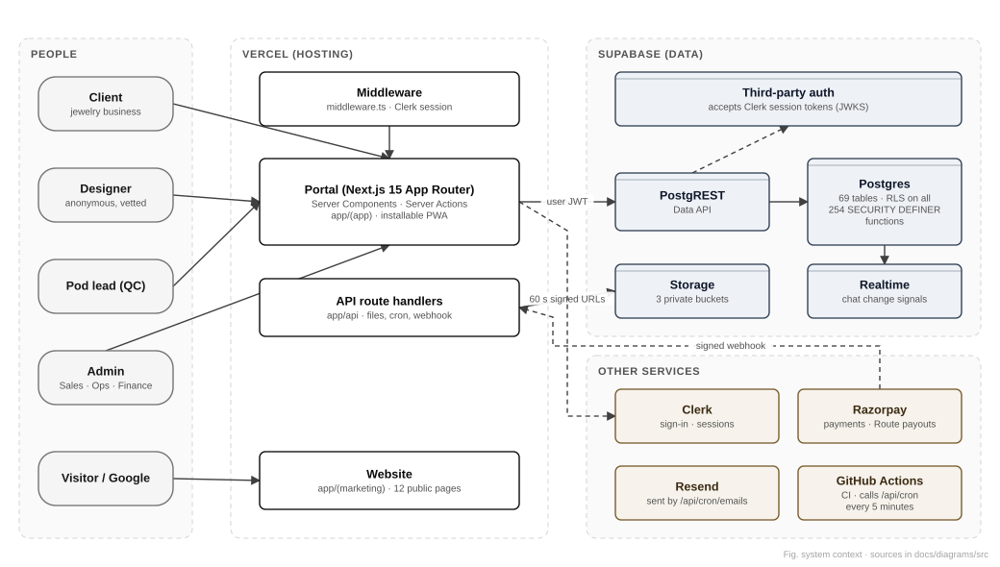

# Executive technical overview

This chapter is the two-page answer to "what have we built, how safe is it, and what needs doing next". Every number in it comes from the repository at the audited revision (see [Audit method and assumptions](../security/19-audit-method-and-assumptions.md)).

## What The CAD Pillar is, technically

The CAD Pillar (TCP) is a brand of Ichizu Private Limited. It sells jewelry CAD design to the trade: a jewelry business sends a brief, an anonymous vetted designer models the piece, an independent reviewer checks it, the client approves, and only then is money released. The software has three faces, all served from one application:

| Face | Who uses it | Where it lives in the code |
|---|---|---|
| Public website | Visitors, Google, prospective clients and designers | `app/(marketing)/` (12 pages) |
| Client portal | Jewelry businesses (clients) | `app/(app)/` routes such as `/home`, `/orders`, `/messages` |
| Team portal | Designers, pod leads (QC), admins (Sales, Ops, Finance) | `app/(app)/` routes such as `/work`, `/pod`, `/qc`, `/admin` |

It is one **Next.js 15** application written in **TypeScript**, hosted on **Vercel**. People sign in with **Clerk**. Data, files and live chat signals live in **Supabase**: Postgres, Storage and Realtime. Payments and payouts go through **Razorpay**. Emails go out through **Resend**, and phone notifications through the Web Push standard. **GitHub** holds the code, runs the automated checks and wakes the scheduled jobs every five minutes.

## The design idea that matters most

**The database is the security boundary, not the screens.** Every one of the 69 tables has row-level security (RLS) switched on, so a table nobody wrote a rule for is closed. The 254 database functions that do privileged work (SECURITY DEFINER functions) each check who is calling. The web application talks to the database *as the signed-in person*, using that person's Clerk session token. So even a bug in a page cannot show a designer a client's name, and it cannot let a client mark their own order as paid. Four other properties follow from the same idea:

- **Double-blind anonymity.** Clients never learn who designed their piece, and designers never learn who the client is. Identities live in separate tables that only admins can read, and every read is written to the audit log.
- **Money is conserved.** Payments sit in an append-only escrow ledger. A database trigger refuses any release or refund larger than what was collected.
- **History is tamper-evident.** Every state change, money movement and identity read is appended to a hash-chained audit log that cannot be edited or deleted.
- **Files are cleaned and protected.** Uploads are checked by their real file signature, metadata is stripped, and delivered files are fingerprinted (SHA-256). Downloads are decided per request and use links that expire in 60 seconds.

## The application in numbers

| Measure | Value |
|---|---|
| Portal and website pages | 73 |
| API route handlers | 20 |
| Server actions (form handlers) | 92, in 31 files |
| Database tables | 69, all with RLS on |
| Database policies | 43 |
| Database functions | 285, of which 254 are SECURITY DEFINER (all with a pinned search path) |
| SQL migration and policy files | 113 |
| Automated tests | 1,201 unit and database tests in 132 files, plus 17 browser journey suites |
| Configuration variables | 34 (names in [Appendix E](../architecture/generated/environment.md)) |
| Real accounts at audit time | 26 people moved to production sign-in on 13 November 2026 |

## Health at a glance

| Area | Status | Why |
|---|---|---|
| Access control | Strong | RLS on every table, privileged functions check the caller, and anonymity is tested in the browser suite |
| Payments and money | Strong | Signed webhook with a constant-time check, idempotent handling and a conserved ledger |
| Files and IP | Strong | Signature checks, metadata stripping, private buckets and 60-second links |
| Dependencies | **Needs action** | Next.js 15.5.19 and four other packages have published security advisories (SEC-01, SEC-04, SEC-05) |
| Infrastructure | **Needs action** | The Supabase plan, credential rotation, email domain protection and the Vercel plan (SEC-02, SEC-03, SEC-07, SEC-08) |
| Code quality and tests | Strong | Strict TypeScript, lint and 1,201 tests run on every pull request; browser journeys run in CI |

The full register is in the [security audit chapter](../security/09-security-audit.md). **No critical vulnerability was found in The CAD Pillar's own code.** The most urgent items are an upgrade of the Next.js framework, and infrastructure settings that only the owner can change.

## The five things to do next

1. **Upgrade Next.js to the latest 15.5 release (15.5.28 or later), together with `sharp` and `zod`**, in one pull request with the full test suite (SEC-01, SEC-04, SEC-05).
2. **Move the production Supabase project off the Free plan** so it gets daily backups and point-in-time recovery and is never paused. Then rehearse a restore (SEC-02, chapter 14).
3. **Rotate the database password and delete the unused Vercel project** that still holds production database credentials (SEC-03).
4. **Protect the email domain:** publish DMARC, move the Google DKIM key to its proper selector, and verify the transactional sender (SEC-07).
5. **Move Vercel to Pro** (commercial use) and give preview deployments their own non-production database (SEC-08).

## How to read this handbook

- **Founders and managers:** chapters 1, 3, 9, 14 and 16, plus the [glossary](./18-glossary.md).
- **New developers:** chapters 2, 4–8, 10–13 and 15, then the appendices.
- **Security reviewers:** chapters 6, 8 and 9, plus [Audit method and assumptions](../security/19-audit-method-and-assumptions.md).

Everything here is generated from Markdown in `docs/`. The PDF and Word files are rebuilt by one command (chapter 13, "Regenerating this handbook").
