# The CAD Pillar — Sales Training Master

INTERNAL — CONFIDENTIAL · Version 1.0 · November 2026 · Owner: Fazil Zaidi

This is the one document a new sales hire studies to sell The CAD Pillar (TCP) without supervision. It covers what we sell, who buys it, how a jewellery CAD order works, how to find and win clients, and how to keep them.

**How numbers are labelled.** Every market or benchmark number carries a label: **(V)** verified source, **(E)** estimate, **(A)** assumption. Prices, promises and policies come from `docs/DECISIONS.md` (version 1.35), the company's source of truth. Where the November briefing and DECISIONS.md disagreed, DECISIONS.md won and the difference is logged in Appendix F. Anything not yet decided is marked **[TBC]** and listed in Appendix G.

## Contents

- Module 0 — How to use this document
- Module 1 — TCP in one page
- Module 2 — Jewellery CAD crash course
- Module 3 — Market and opportunity
- Module 4 — Who we sell to
- Module 5 — Product and workflow from the client's side
- Module 6 — Commercial terms
- Module 7 — Competitive landscape and battlecards
- Module 8 — Prospecting
- Module 9 — Outreach playbook
- Module 10 — Discovery and qualification
- Module 11 — Guiding the client to the first order
- Module 12 — Objection handling
- Module 13 — Account management and growth
- Module 14 — Targets, metrics and daily routine
- Module 15 — Role-plays
- Module 16 — Rules and red lines
- Appendix A — Glossary
- Appendix B — One-page cheat sheet
- Appendix C — Template library
- Appendix D — Objection quick card
- Appendix E — Managers only (held separately)
- Appendix F — Conflicts resolved
- Appendix G — Open questions for Fazil
- Appendix H — Sources

# Module 0 — How to use this document

**Learning goal:** know how to study this document, what you must be able to do by day 90, and how you are certified.

## 0.1 How to study it

1. Read Modules 1–7 in your first week. They teach the product and the market. You cannot sell what you cannot explain.
2. Read Modules 8–12 before you send your first message. They teach the daily work.
3. Read Modules 13–16 before your first client pays.
4. Answer the quiz at the end of every module in writing. Your manager holds the answer key (`answer-key.md`).
5. Keep Appendix B (cheat sheet) and Appendix D (objection quick card) open while you work.

> **Rule:** If a client asks something this document does not answer, do not guess. Say "Let me confirm that and come back to you today," then ask the Client Acquisition Lead or Fazil.

## 0.2 Your 30/60/90-day plan

| Period | What you do | What "good" looks like at the end |
| --- | --- | --- |
| Days 1–7 | Study Modules 1–12. Shadow the Client Acquisition Lead. Set up your inboxes, signature and CRM access. Pass quizzes 0–7. | You can give the 10-second, 30-second and 2-minute pitch from memory. You can read a brief and say what is missing. |
| Days 8–30 | Start prospecting your market at the ramp volume (Module 9.6). Research 25 verified prospects a day with a real buying signal. Reply to every reply within 2 business hours. Pass quizzes 8–16 and role-plays 1–3. | Every prospect logged with a signal grade. Hard bounces under 1%. Every reply logged the same day. First qualified briefs passed to the Client Acquisition Lead. |
| Days 31–60 | Full daily standard. Run discovery calls for fit accounts. Coach clients through their first brief. Role-plays 4–6. | Positive replies answered within 1 hour. Qualified briefs every week. You can explain the guarantee, the SLA and the revisions policy without notes. |
| Days 61–90 | Own your pipeline end to end: first order, approval, credits offer, second order. | First paying clients from your own prospecting. Every paying client has a next action and a date in the CRM. |

## 0.3 Certification checklist

You are certified to work without supervision when your manager has ticked every line.

| # | Skill | How it is checked |
| --- | --- | --- |
| 1 | Pitches (10-second, 30-second, 2-minute) from memory | Spoken to manager |
| 2 | Explains a jewellery CAD brief and spots missing information | Given three sample briefs, lists what is missing in each |
| 3 | Knows every price, plan and policy in Module 6 | Quiz 6 with no errors on prices |
| 4 | Explains the difference between "castable to spec" and "casting outcome" | Role-play 4 |
| 5 | Explains the 6-hour promise and when the clock starts | Role-play 2 |
| 6 | Researches a lead in 8 minutes or less and grades the signal | Live exercise, 5 leads |
| 7 | Writes a compliant first email (≤120 words, one CTA, opt-out, postal address) | 3 emails reviewed |
| 8 | Handles the top 10 objections | Role-play 3 and quick-fire round |
| 9 | Runs a discovery call with the 4 qualifying questions | Role-play 5 |
| 10 | Knows the red lines in Module 16 | Quiz 16 with no errors |

> **Key takeaways**
> - Study in order: product and market first, daily work second, growth last.
> - Never guess an answer to a client. Confirm and come back the same day.
> - Certification is skills shown, not pages read.

**Quiz — Module 0**

1. In what order should you study the modules, and why?
2. What do you say when a client asks something this document does not answer?
3. What are three things that show you are on track at day 30?
4. Name four of the ten certification skills.

# Module 1 — TCP in one page

**Learning goal:** explain what TCP sells, to whom, and why they should choose us, in 10 seconds, 30 seconds and 2 minutes.

## 1.1 What we sell

The CAD Pillar is **your on-demand CAD department** for jewellery businesses. We are a **managed CAD studio**. We turn a jeweller's sketch, photo or brief into a manufacturing-ready CAD file they can print and cast.

- **Who runs it:** Ichizu Private Limited. The studio is in **New Delhi, India**.
- **Who buys it:** jewellery businesses only (B2B). Never consumers.
- **What they get on every order:** the 3DM and STL files, a render image, a technical sheet, a QC certificate that doubles as the spec sheet, a weight sheet, a summary sheet, and a 3D preview link they can send to their own customer. Module 5 explains each one.
- **What we sell today:** jewellery CAD and renders. We also do render-only orders and CAD file repair. Dental and watch CAD are possible future lines under a separate brand; do not sell them.

> **Never say this:** "We're a marketplace." "We connect you with freelancers." We are one studio that owns the result.

## 1.2 Who it is for

| Who | Why they buy |
| --- | --- |
| Casting houses, trade shops, print bureaus | Their CAD person is the bottleneck. More CAD means more casting work. |
| Fine-jewellery manufacturers | In-house CAD is maxed out. They need overflow capacity. |
| CAD studios and freelancers | They are booked out and need white-label overflow. |
| Wholesalers and private-label brands | Line launches need CAD and renders on a deadline. |
| DTC and online custom or lab-grown bridal brands | Launch dates slip without reliable CAD. |
| Custom and bridal retailers (1–5 stores) | Their customer waits days for a CAD to look at. |

## 1.3 Why us

No competitor in our 69-company study offers all five of these together:

1. **A guaranteed turnaround with a credit.** First look within 6 hours of order confirmation (standard work), or the full amount is credited and we still finish the job.
2. **Castable files, guaranteed to spec.** If a delivered file breaks its own spec sheet, we fix it free and refund the CAD fee.
3. **Transparent prices.** From $35 a design, quoted before any work starts.
4. **A portal** with order history, chat per order, invoices and easy reorders.
5. **Published plans** for regular clients: volume credits, a monthly partner plan and a dedicated designer.

Plus: **white-label by default** (nothing carries our name unless the client asks), **NDA by default**, **the client owns the IP on payment**, and **double-blind** working (our designers never see the client's customer, store name or contacts).

## 1.4 The one-line promise

> **Say this:** "Send one design. First look within 6 hours of order confirmation, or it's free."

"Order confirmation" means the client has paid and we have confirmed the brief is complete. Module 5.4 explains it. Always say "order confirmation", never "payment", because the clock starts when both have happened.

## 1.5 Elevator pitches

**10 seconds**

> **Say this:** "We're The CAD Pillar, an on-demand CAD department for jewellery businesses. Send one design and you get a first look within 6 hours of order confirmation, or it's free."

**30 seconds**

> **Say this:** "We're The CAD Pillar. We build manufacturing-ready jewellery CAD for stores, brands and manufacturers: 3DM and STL, a render and a spec sheet with every file. Every file is checked twice before you see it. Standard work comes back for a first look within 6 hours of order confirmation, or we credit the full amount. Files are castable to spec, guaranteed. Everything is white-label, under NDA, and you own the files once paid. Prices start at $35 a design. Want to send me one job you have open?"

**2 minutes (for a call)**

> **Say this:** "Most jewellers we talk to have the same problem: custom work comes in faster than CAD can be done. Either the CAD person is overloaded, or the outside designer takes days and gets the brief wrong.
>
> We're The CAD Pillar, a managed CAD studio based in New Delhi. Think of us as your CAD department on demand. You send a sketch, photo or brief through our portal, by email or on WhatsApp. We price it before any work starts. Once it's paid and the brief is confirmed, a senior designer builds it and a second person checks it against a two-stage quality checklist before you ever see it.
>
> For standard pieces, you get a first look within 6 hours of order confirmation, or we credit the full amount and still finish the work. Every delivery comes with the 3DM and STL, a render, a technical sheet with measurements and weights, and a QC certificate that is also the spec sheet. If a file breaks that spec, we fix it free and refund the CAD fee.
>
> It's all white-label. Our designers never see your customer, and you own the files once paid. Prices start at $35 a design, and regular clients move to credits or a monthly plan.
>
> The easiest way to judge us is one real job. What's one piece you have waiting right now?"

> **Key takeaways**
> - We are a managed CAD studio, never a marketplace.
> - Five things together make us different: guaranteed turnaround, castable-to-spec guarantee, clear prices, a portal, published plans.
> - The promise counts from order confirmation (paid and brief confirmed), not from first contact.
> - Every pitch ends with one ask: send one real job.

**Quiz — Module 1**

1. Give the 10-second pitch word for word.
2. What does "order confirmation" mean, and why do we say it instead of "payment"?
3. Name the five things no competitor offers all together.
4. Why must you never call TCP a marketplace?
5. Which product lines must you not sell today?
# Module 2 — Jewellery CAD crash course

**Learning goal:** speak the client's language, read a brief, and explain why a file can fail at the bench.

You do not need to design. You need to understand what the client is asking for, spot a brief that will cost a day, and explain why our checks matter.

## 2.1 What jewellery CAD is

A jeweller used to carve a wax model by hand, then cast it in metal. Today most custom pieces start as a **CAD model** (computer-aided design). The model is printed in castable resin or wax, the print is cast in gold or platinum, and a bench jeweller finishes the piece and sets the stones.

So our file is not a picture. It is the master from which real metal is made. If the file is wrong, the metal is wrong.

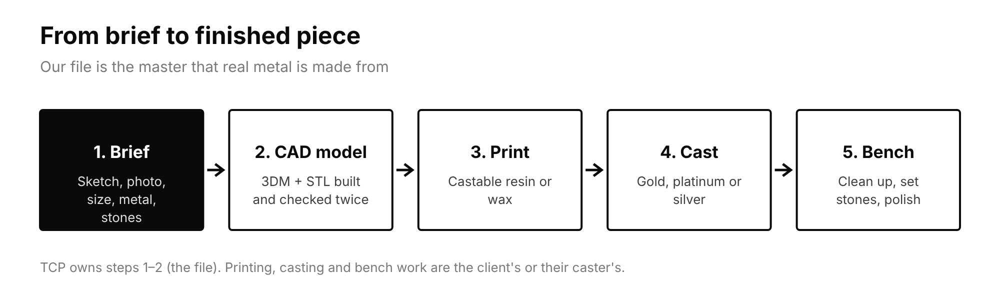

## 2.2 Anatomy of a ring

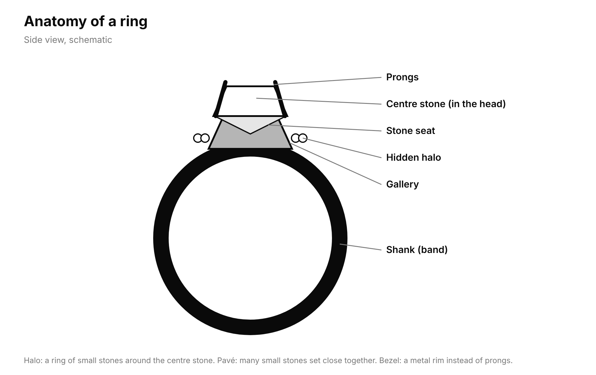

| Term | What it means | Why the client cares |
| --- | --- | --- |
| **Shank** | The band that goes round the finger. | Its thickness and width decide comfort, strength and metal weight. |
| **Head** | The part on top that holds the centre stone. | It must fit the exact stone. |
| **Prongs** | The small metal claws that hold a stone. | Too thin and they break; too thick and the stone looks small. |
| **Gallery** | The side profile under the head, often decorated. | A design detail customers notice from the side. |
| **Halo** | A ring of small stones around the centre stone. | Makes the centre look bigger. Common in bridal. |
| **Hidden halo** | A halo set under the centre stone, seen from the side. | A popular bridal detail; a typical mid-complexity job. |
| **Pavé** | Many small stones set close together, held by tiny beads of metal. | Needs exact seat sizes and spacing. |
| **Bezel** | A metal rim that wraps around a stone instead of prongs. | Secure and modern; the wall must be the right height. |
| **Stone seat** | The cut-out in the metal where a stone sits. | Wrong seat = the stone will not sit or will fall out. This is a top reason clients leave a supplier. |

## 2.3 File and quality terms

| Term | What it means |
| --- | --- |
| **3DM** | The native file of Rhino, the main jewellery CAD software. Editable: the client's own CAD person can change it later. |
| **STL** | A mesh file made of triangles. It is what the printer reads. |
| **Mesh** | The surface of triangles in an STL. A finer mesh is smoother. We export with a maximum distance/edge of 0.005. |
| **Naked (open) edges** | Gaps in the model's surface. A model with naked edges is not "watertight" and can print or cast badly. We check for none. |
| **Castability** | Whether the piece can be printed and cast successfully: walls thick enough, prongs strong enough, no open edges, metal able to flow. |
| **Shrinkage** | Metal shrinks slightly as it cools after casting. Casters allow for it. The amount depends on the alloy and the caster's process, so ask the client if their caster needs an allowance. |
| **Wall thickness** | How thick the metal is at its thinnest point. Too thin = the piece breaks or does not cast. |
| **Weight** | We estimate the metal weight from the model's volume, in 10K, 14K, 18K, platinum (Pt950) and silver (Ag925). Clients use it to price the piece for their customer. |
| **Render** | A photo-real image of the CAD model. The client shows it to their customer. |

Software we use: **Rhino** and **MatrixGold**, and **ZBrush** for organic and sculpted pieces. The client receives 3DM and STL whatever we used.

## 2.4 Ring sizes by country

Ring sizes use different systems in different countries. A wrong system means a ring that does not fit. Always ask: **"Which country's sizing is that?"**

| Country | System | Example |
| --- | --- | --- |
| USA, Canada | Numbers with halves (5, 5½, 6 …) | US 6 |
| UK, Australia, New Zealand | Letters with halves (J, K, L½ …) | UK L½ |
| Europe (Germany, France, Italy, Spain and others) | Inside circumference in millimetres | EU 52 |

Common sizes, for orientation only. The client's own sizer always wins.

| US | UK / AU | EU (circumference, mm) | Inside diameter (mm) |
| --- | --- | --- | --- |
| 5 | J½ | 49.3 | 15.7 |
| 6 | L½ | 51.9 | 16.5 |
| 7 | N½ | 54.4 | 17.3 |
| 8 | P½ | 57.0 | 18.1 |
| 9 | R½ | 59.5 | 18.9 |

> **Rule:** never convert a size yourself in a message to a client. Send the size and the country to the order; the brief records both.

## 2.5 What a good brief contains

The portal will not accept a brief without the minimum: the product type, at least one reference image, the size, the metal, and whether there is a centre stone (with its shape and size if so). A brief that is only "minimum" often still costs a question.

Coach every client to send all of this:

1. **Size or dimensions**, with the country's sizing system (ring size, or bangle/bracelet inner size or length).
2. **Metal and karat** (for example 14K yellow gold, 18K white gold, platinum).
3. **Stones:** shape, size and count, centre stone separately from side stones.
4. **Setting style** (prongs, bezel, pavé, halo, hidden halo).
5. **References:** sketch, photos, or a past design to follow.
6. **How it will be made:** casting or direct printing, and anything the caster needs.
7. **File format** wanted (3DM, STL, or both).

**Why it matters:** our designers work while the US sleeps. One missing answer can cost a full day, because the question waits for the client's next morning.

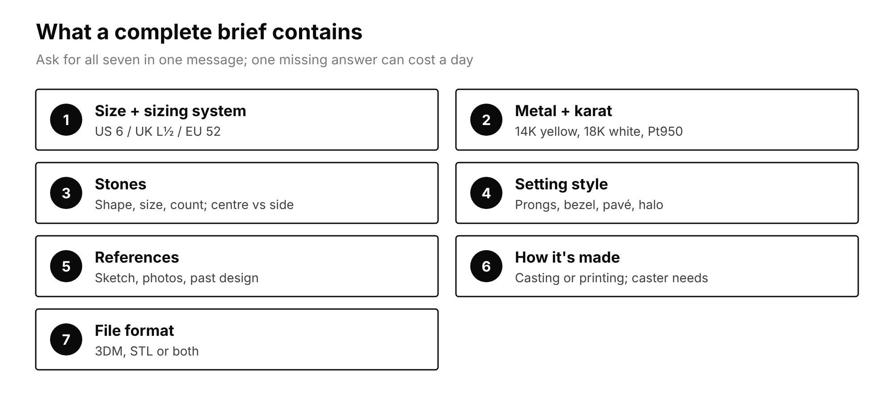

## 2.6 What fails at the bench, and why QC matters

| What goes wrong | What the jeweller sees | How our check prevents it |
| --- | --- | --- |
| Stone seat the wrong size | The stone will not sit, or sits loose | Designer and QC both check stone sizes, shapes and count against the brief |
| Prongs or walls too thin | Breaks in casting or in wear | Measurements are recorded on the spec sheet |
| Open (naked) edges | Print fails or casting has holes | Designer check: "no open or naked edges" |
| Wrong ring size | Ring must be resized or remade | Size and all measurements are checked twice |
| Brief detail missed | A full revision round lost | Both stages check "the client's special remarks" |

Our quality system has **two stages**:

- **Stage 1, the designer's check (9 lines):** size and all measurements; diamond sizes, colours and count; setting type; metal colour and karat; the client's special remarks; overall look with every measurement marked; no open or naked edges; STL mesh within 0.005; all files exported (3DM, STL, render, technical image). The designer cannot submit until every line passes.
- **Stage 2, the QC check (5 lines, by the pod lead, never the designer):** overall look; diamond sizes, shapes and colours; all measurements; setting type, metal colour and karat; the client's special remarks. QC cannot approve until every line passes.

> **Say this:** "Every file is checked by the designer and then by a second person before you see it. The measurements they checked are on your spec sheet."

> **Key takeaways**
> - The CAD file is the master for real metal. A wrong file means wrong metal.
> - Stone seats, thin walls, open edges and wrong sizes are what fail at the bench.
> - Always ask which country's ring size a client means.
> - A complete brief saves a full day; coach for all seven items.

**Quiz — Module 2**

1. What is the difference between a 3DM and an STL file?
2. A client writes "size 7". What do you ask, and why?
3. Name the seven things a complete brief contains.
4. What are naked edges and why do they matter?
5. Who does the Stage 2 check, and who can never do it?
# Module 3 — Market and opportunity

**Learning goal:** know where the buyers are, how many there are, when they buy, and what threatens the market.

## 3.1 Count buyers, not stores

There are roughly 100,000 jewellery businesses across our 14 study markets (E). Only about **12,600** of them actually buy CAD from outside (E). Your job is to find those buyers, not to email every store.

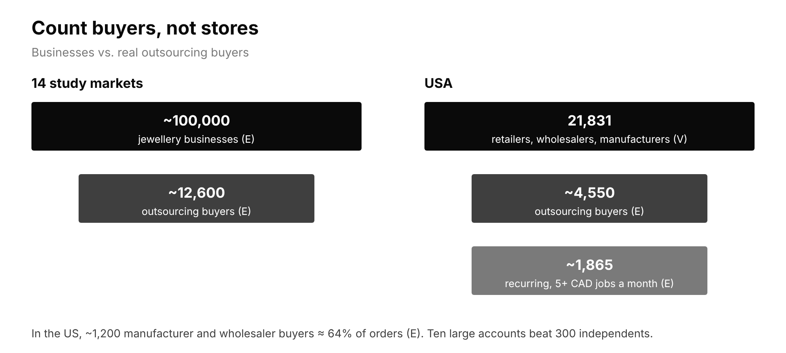

Volume follows a power law. In the US, about 1,200 manufacturer and wholesaler buyers account for about 64% of orders (E). **Ten large accounts beat 300 independents.** This is why Tier 1 segments and channel partners come first (Module 4).

## 3.2 Market size by country (14-market study, November 2026)

All figures are estimates (E) unless marked (V).

| Country | Manufacturers | Retailers | Outsourcing buyers (E) | Orders / month (E) | Annual market (E) |
| --- | --- | --- | --- | --- | --- |
| USA | ~2,000 (V), plus ~3,250 wholesalers (V) | ~16,900 firms (V), ~95% independent | ~4,550 | ~56,000 | ~$60M |
| UK | 1,385 (V) | 4,545 stores (V) + ~3,000 online (V) | ~1,300 | ~14,400 | ~$15M |
| Australia | 1,440 (V) | 1,967 (V) | ~890 | ~9,500 | ~$10M |
| Canada | 1,448 (V) | 2,980 (V) | ~785 | ~9,700 | ~$9M |
| Germany | 3,307 (V) | 9,000+ (V) | ~1,200 | ~13,600 | ~$13M |
| France | 17,450 (V) (fine ~3,500, E) | ~7,000 | ~900 | ~9,700 | ~$9M |
| Italy | ~6,800 (V) | ~12,000 | ~840 | ~14,700 | ~$9M |
| Spain | 2,183 (V) | 4,639 (V) | ~575 | ~6,100 | ~$4M |
| Netherlands | ~2,600 (V) (fine ~800) | ~2,000 | ~480 | ~3,600 | ~$3M |
| Switzerland | ~500 | ~1,200 | ~150 | ~2,600 | ~$3.4M |
| UAE | ~400 | ~2,000 national; chains >50% | ~360 | ~10,200 | ~$3.7M |
| Saudi Arabia | ~300 | ~5,000 | ~270 | ~5,400 | ~$2.3M |
| New Zealand | ~250 | 317 (V) | ~170 | ~1,150 | ~$1M |
| **Total** | | | **~12,600 buyers** | **~157,000 / month** | **~$142M / year** |

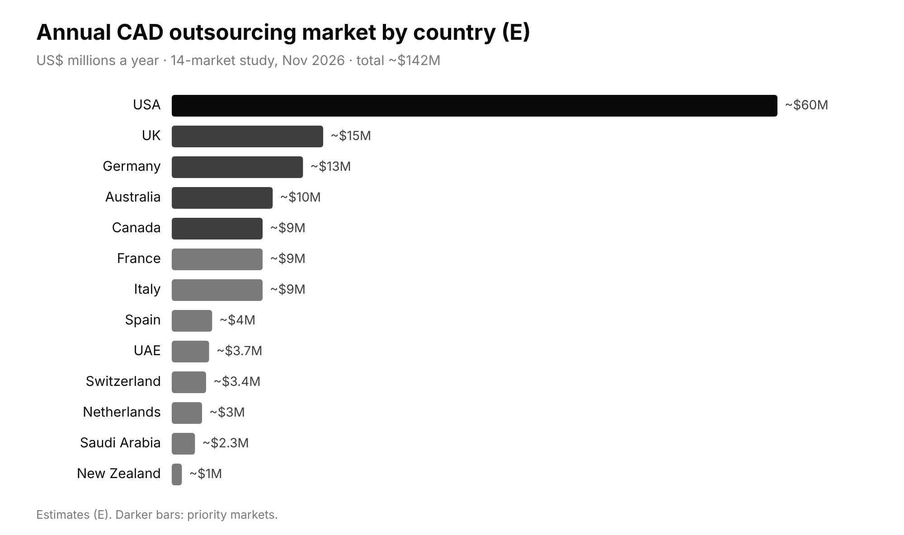

## 3.3 Where we focus

Each country was scored out of 25.

| Country | Score | Why |
| --- | --- | --- |
| USA | 20 | The volume engine. |
| Australia | 20 | Highest margin; Australian business hours are the Indian day. |
| UK | 19 | Overlaps the Indian afternoon and evening. |
| Canada | 18 | A bolt-on to the US work. |
| Germany | 17 | Needs a German speaker; cold email needs prior consent (Module 9.8). |
| Netherlands | 16 | |
| New Zealand | 16 | |
| France | 15 | |
| Switzerland | 14 | |
| UAE | 13 | Large manufacturers only. |
| Italy, Spain, Saudi Arabia | 12 | Deferred. |
| Hungary | 9 | Not a target. |

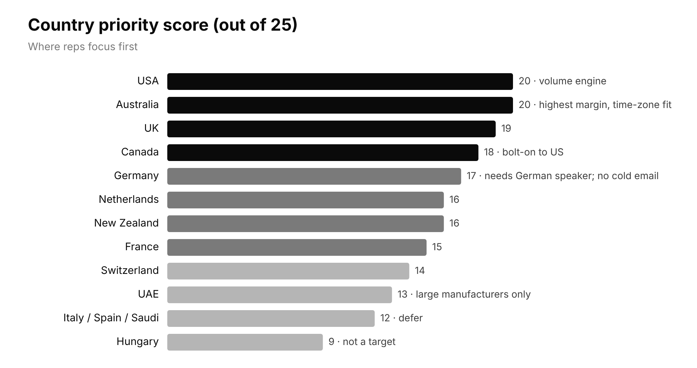

**What a market will pay** for a typical mid-complexity job, a hidden-halo ring CAD (E):

| Market | Realistic price (E) |
| --- | --- |
| USA | $45–80 (sweet spot $55–65) |
| UK | £40–60 |
| Australia | A$70–110 |
| Canada | C$65–100 |
| UAE / Saudi Arabia | $15–40 (price war with Surat and Mumbai; not a priority) |

Our Complex price for this kind of piece is $85 and our Standard price is $35 (Module 6). Price is set by the team on each quote; you never quote a number the team has not approved.

## 3.4 The US market in detail

| Fact | Number | Label |
| --- | --- | --- |
| Retailers (JBT Q3 2026) | 16,564 | V |
| Wholesalers (JBT Q3 2026) | 3,206 | V |
| Manufacturers (JBT Q3 2026) | 2,061 | V |
| Total, shrinking about 1.5% a year | 21,831 | V |
| Independents offering paid custom design (INSTORE 2025) | 95% | V |
| Independents calling custom their main differentiator | 32% | V |
| Independents reporting sales over $1M | 58% | V |
| Average survey respondent age | 62 | V |
| Businesses realistically recurring (5+ CAD jobs a month) | ~1,865 | E |
| CAD jobs a year | ~1.6M | E |

**What this means for you:** custom work is how independents compete. Many owners are older and have no CAD skills in-house. Speak plainly and make ordering easy.

## 3.5 Seasonality

| Period | What happens | What you do |
| --- | --- | --- |
| October–December | ≈34.7% of US jewellery store sales; December alone ≈19.7% (V, older data) | Pitch capacity for the rush before December. Retail sends pause 11 Dec–4 Jan. |
| Mid-December | Retailers are too busy to talk | Focus on brands and manufacturers until 18 Dec. |
| January–February | Volume trough | Best time for pilots and first orders. |
| November–February | Engagement season | Bridal angles work. |
| Winter | Gulf weddings peak | Relevant only for UAE manufacturers. |

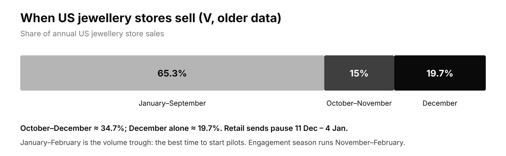

## 3.6 Trends and threats

- **Revenue up, units down.** US independent store revenue rose about 27% while units fell 12% (Q1 2024 → Q1 2026, V). CAD demand follows units, not revenue.
- **Gold is expensive.** About $4,480/oz in May 2026 (V). Sell **redesigns and metal-lightening changes**: the same look with less gold.
- **AI CAD tools.** Pencil launched an AI agent that produces castable parametric ring CAD (May 2026, V). Simple jobs (categories A–C) will become a commodity within 12–36 months (E).
- **Our answer:** we win on manufacturability QC, complex pieces and speed in US hours. Do not compete on simple bands alone.
- **The main competitor is India,** not local bureaus. Other India-based studios sell the same promise at low prices. We win on guarantees and process (Module 7).

> **Key takeaways**
> - ~12,600 real buyers (E), not 100,000 stores. Volume is concentrated in manufacturers and wholesalers.
> - Priorities: USA, Australia, UK, Canada.
> - Use January–February for pilots; respect the December pause.
> - AI will take simple work. Sell QC, complex pieces and speed.

**Quiz — Module 3**

1. About how many outsourcing buyers are there across the 14 markets, and why is that number more useful than the number of stores?
2. Which two countries score highest, and why is Australia attractive?
3. When do retail sends pause, and when are pilots easiest to start?
4. What does "revenue up, units down" mean for CAD demand, and what do you sell because of it?
5. Which kinds of jobs are most at risk from AI tools, and where do we win instead?
# Module 4 — Who we sell to

**Learning goal:** pick the right companies and the right person, spot the moment they need us, and know who not to chase.

## 4.1 Segments and tiers

Each segment is scored out of 100 for fit.

| Segment | Score | Tier | Who decides | Their pain |
| --- | --- | --- | --- | --- |
| Casting houses, trade shops, print bureaus | 84 | 1 | Owner | The CAD person is the bottleneck. |
| Fine-jewellery manufacturers | 81 | 1 | Owner, production head | In-house CAD is maxed out. |
| CAD studios and freelancers (white-label overflow) | 72 | 2 | Owner | Booked out; turning work away. |
| Wholesalers and private-label | 69 | 2 | Owner, product lead | Line launches need CAD and renders; lumpy (2–4 launches a year). |
| DTC and online custom or lab-grown bridal brands | 65 | 2 | Founder, product lead | Launch dates slip. |
| Custom and bridal retailers (1–5 stores) | 60 | 2 | Owner | The customer waits days for a CAD. |
| Bench jewellers | 45 | 3 | — | No outbound. Inbound and content only. |
| Small Etsy and Shopify sellers | 44 | 3 | — | No outbound. Inbound and content only. |

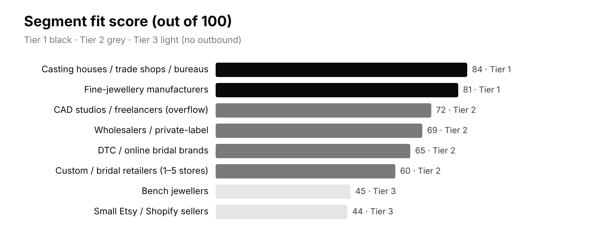

> **Rule:** lead with channel partners. One casting house that white-labels our CAD can bring the volume of 10–20 retailers.

## 4.2 Personas

**The casting-house owner (Tier 1).** Runs printers and casting. Gets CAD requests from retailers all day; one in-house CAD person cannot keep up. Wants: reliable files that cast first time, fast, under their own name. Fears: a supplier who makes their customers wait or files that fail in their own casting. Ask: "How many CAD jobs are waiting today?"

**The manufacturer's production head (Tier 1).** Manages a team and a production calendar. In-house CAD is full, especially before shows and launches. Wants: overflow capacity that follows their standards. Fears: losing control of quality and IP. Ask: "What happens to CAD when your designers are full?"

**The CAD studio owner or freelancer (Tier 2).** Already sells CAD. Booked out. Wants: white-label overflow at a margin, their name on the work. Fears: we steal their client (we never contact their customers; double-blind).

**The DTC or bridal brand founder (Tier 2).** Online custom rings, often lab-grown. Launches collections. Wants: CAD plus renders on a date. Fears: a missed launch.

**The independent retail owner (Tier 2).** One to five stores; custom is how they compete. Often no CAD skills in-house. Wants: show the customer a CAD quickly so the sale does not walk out. Fears: complexity and surprise costs. Minimum fit: **5 or more custom pieces a month.**

## 4.3 Buying triggers

A trigger is a public sign that a company needs CAD now. Every message you send should come from one.

| Trigger | Angle | Ask |
| --- | --- | --- |
| Hiring a CAD, Rhino or Matrix designer | "Cover the gap while you hire." | "Send me 3 backlog jobs." |
| Bridal or holiday rush (Oct–Feb) | "Don't turn custom orders away." | "Should we hold capacity for you?" |
| New collection or launch | "Your next collection in CAD and renders, on time." | "Which pieces are next?" |
| Trade-show exhibitor (JCK, JIS, Centurion) | "Samples designed in time." | "When's your deadline?" |
| New store or expansion | "A custom counter for the new store." | "Want me to quote one custom job?" |
| Custom or bridal page pushed | "Show customers their ring in CAD the same day." | "Send one design, from $35." |
| Printer or casting capacity added | "Keep the printer busy." | "Send me 3 jobs." |
| Reviews mention slow custom work | "Custom in days, not weeks." | "Want me to quote one custom job you have open?" |
| Freelancer posts "booked out" | "White-label overflow, your name on it." | "Send me the next one you'd turn away." |
| Posts about cost pressure | "A designer when you need one, not a salary." | "Send one job and compare." |

## 4.4 Disqualifiers

Do not spend time on:

- **Consumers.** We are trade only.
- **Tier 3** (bench jewellers, small Etsy and Shopify sellers) by outbound. Answer them if they come to us.
- **Retailers doing fewer than 5 custom pieces a month.** Too little volume to repeat.
- **Germany and Austria by cold email** (prior consent is required even B2B). Other EU countries only after a legal check.
- **UAE and Saudi Arabia retailers** (price war). UAE large manufacturers only.
- **Italy, Spain and Saudi Arabia** for now (deferred).
- **Anyone asking for** unlimited revisions, net-30 on a first order, or exclusivity in a pilot as a condition. Escalate (Module 16).

## 4.5 Who to contact

| Contact first | Never contact first |
| --- | --- |
| Owner, founder, production head, product lead, head of CAD | Junior designers |
| For retailers: the owner | Marketing coordinators |
| For Tier 1: a named person, found on the website or a public profile | `info@` inboxes for Tier 1 companies |

> **Key takeaways**
> - Tier 1 (casting houses, manufacturers) first; channel partners multiply volume.
> - Every message starts from a real trigger.
> - Retailers need 5+ custom pieces a month to be worth pursuing.
> - Contact the decision-maker by name; never a junior or a generic inbox for Tier 1.

**Quiz — Module 4**

1. Which two segments are Tier 1, and what is their shared pain?
2. Why do we lead with channel partners?
3. A Rhino designer job ad appears on a manufacturer's careers page. What is your angle and your ask?
4. Name four disqualifiers.
5. Who must you never contact first at a Tier 1 company?
# Module 5 — Product and workflow from the client's side

**Learning goal:** walk a client through an order from brief to final files, and know who does what at each step.

## 5.1 How an order arrives

A client can order three ways:

1. **The portal** (best). On a desktop, ordering is one page; on a phone it is a few short steps. The brief form will not submit without the minimum information.
2. **WhatsApp or email.** An admin or pod lead creates the order in the portal for the client. At least one screenshot of the request is required. The order then appears in the client's own portal like any other.
3. **Phone.** Same as WhatsApp or email: the team creates the order on the client's behalf.

**New clients are verified first.** Someone who signs up themselves gives their name, business, type, country, address, website or Instagram, and at least one proof of business registration (for example an EIN letter, a state registration, a sales-tax or resale certificate, or a business licence). An admin approves it before the portal opens for ordering. Tell new clients this before they sign up so it is not a surprise. Proofs are seen by admins only. How long approval takes is **[TBC]**.

## 5.2 The workflow, step by step

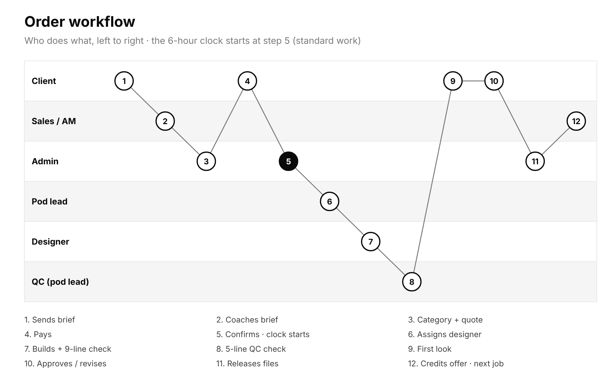

| Step | Who | What happens |
| --- | --- | --- |
| 1 | Client | Sends a brief: sketch, photo or references, size, metal, stones. |
| 2 | Sales / account manager | Checks the brief is complete and coaches the client on anything missing. |
| 3 | Admin | Sets the category and the price (the quote). |
| 4 | Client | Pays the quote. |
| 5 | Admin | Confirms the order once the brief is complete. **The 6-hour clock starts here** (paid and confirmed, whichever is last). Chooses the pod. |
| 6 | Pod lead | Assigns a designer from the pod. |
| 7 | Designer | Builds the model and completes the 9-line designer check. Cannot submit until every line passes. |
| 8 | Pod lead (QC) | Completes the 5-line QC check. Sends it back with the failed lines, or approves. |
| 9 | Client | Receives the first look (renders or files for approval). |
| 10 | Client | Approves, or asks for changes (2 rounds within 14 days of first look). |
| 11 | Team | Releases the final files, QC certificate, weight sheet, summary sheet and preview link. |
| 12 | Sales / account manager | Offers credits the same day as approval and asks for the next job. |

**Who the client talks to.** The client deals only with TCP. In the portal, the client sees everyone on our side as "Your team"; staff names are not shown. An admin can name an account manager for a client. Designers never write in client threads, and never see the client's identity, prices or their client's customer. This is **double-blind** working.

## 5.3 Job categories and the speed promise

Every order gets one category, A to L, by the time the design takes. The admin or pod lead sets it before quoting.

| Category | Design time | Tier | Speed promise |
| --- | --- | --- | --- |
| A | 15 min | Standard | First look within 6 hours of order confirmation |
| B | 30 min | Standard | First look within 6 hours |
| C | 45 min | Standard | First look within 6 hours |
| D | 60 min | Standard | First look within 6 hours |
| E | 90 min | Standard | First look within 6 hours |
| F | 120 min | Standard | First look within 6 hours |
| G | 180 min | Complex | Firm deadline stated with the price |
| H | 240 min | Complex | Firm deadline stated with the price |
| I | 300 min | Complex | Firm deadline stated with the price |
| J | 360 min | Complex | Firm deadline stated with the price |
| K | 420 min | Complex | Firm deadline stated with the price |
| L | 480 min | Complex | Firm deadline stated with the price |

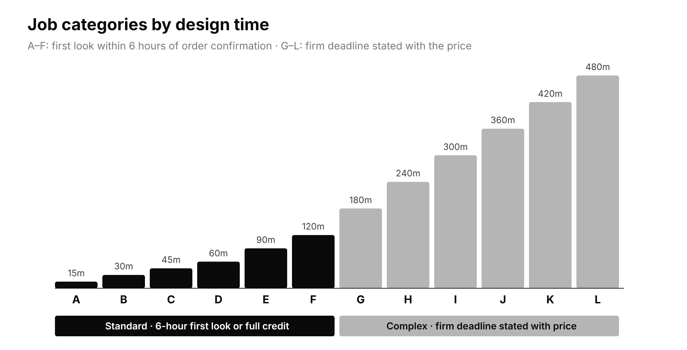

## 5.4 The 6-hour promise, exactly

- **Applies to:** categories A–F.
- **Clock starts:** when the order is both **paid** and **confirmed**, at whichever happens last. "Paid" means the client paid by card, or the team marked a bank, Wise or PayPal payment received. "Confirmed" means the team pressed "Confirm order" once the brief is complete and any questions are answered.
- **Met:** the first look (renders or files for approval) reaches the client before the deadline.
- **Missed:** the full amount paid is credited to the client, once, and the work is still completed.
- **Categories G–L:** a firm deadline is stated with the price, before the client pays. There is no automatic credit.

> **Say this:** "Once it's paid and we've confirmed the brief, you'll have a first look within 6 hours. If we miss it, the full amount is credited to you and we still finish the work."

> **Never say this:** "6 hours from when you email us." "6 hours guaranteed for everything." "Overnight." The clock needs payment and a complete brief, and complex pieces have their own deadline.

This is why brief coaching matters: an incomplete brief is not confirmed, so the clock has not started and the client waits.

## 5.5 What the client receives on every order

| Deliverable | What it is | Why it matters to the client |
| --- | --- | --- |
| **3DM + STL** | The editable model and the print file (mesh max distance/edge 0.005) | Ready to print and cast; their own CAD person can edit the 3DM. |
| **Render image** | One image with four render views | Shows their customer the design. |
| **Technical sheet** | One image with four views, measurements, diamond details and gold weight by karat | The bench and the caster work from it. |
| **QC certificate (PDF)** | The signed check, which doubles as the **spec sheet** | The basis of our "castable to spec" guarantee. |
| **Weight sheet** | Estimated grams in 10K, 14K, 18K, Pt950 and Ag925 | Lets them price metal. It shows grams only; there is no metal cost on it. |
| **Summary sheet (PDF)** | The order, both images, stones, weights, time taken and timeline | One document for their records, from approval on. |
| **3D preview link** | A 3D view and renders they can send to their own customer, white-label | Helps them close the sale with their customer. |

Delivered files are fingerprinted and archived read-only. That is how we check a guarantee claim later.

## 5.6 The portal

- **Orders:** every order with its status, files, and a chat thread per order.
- **Messages:** one thread per order, with "Your team".
- **Account:** business details, and **master instructions**: the client's standing rules for every order (for example their factory's standards), written once and shown to the team on every job. Clients can also upload diamond certificates.
- **Wallet:** shows credit (for example an SLA credit) and payments on open orders. Topping up the wallet and paying from it is **[TBC: not live yet]**.
- **Invoices:** one invoice per paid order, issued automatically, downloadable as a PDF.
- **Pay:** card checkout in the portal; bank transfer or Wise with "I've paid" so finance can confirm.

**IDs you will see:** order IDs follow `TCP-J{YYMMDD}-###` (J = jewellery), and client IDs follow `CL-####` **[TBC: confirm format]**.

## 5.7 Time zones

| Client region | Their business hours fall in… | What it means |
| --- | --- | --- |
| USA | The Indian night | Designers work it; a US client sends a brief in the morning and sees a first look the same day. |
| Australia | The Indian day | Easy overlap for questions and approvals. |
| UK | The Indian afternoon and evening | Good overlap. |

The most valuable window for calls and approvals is the **US overlap in the Indian evening**. Live support by phone and WhatsApp answers **3 PM – midnight India time** every day (5:30 AM – 2:30 PM ET in US daylight time; 4:30 AM – 1:30 PM ET in standard time). The portal is open 24/7.

> **Key takeaways**
> - The client deals only with TCP. Designers and clients never meet.
> - The 6-hour clock starts when the order is paid and confirmed; a complete brief starts it sooner.
> - Every order includes seven deliverables; the QC certificate is the spec sheet.
> - New self-signed-up clients are verified before they can order.

**Quiz — Module 5**

1. List the 12 workflow steps in order and name who owns each.
2. A client paid at 9 AM but the brief was confirmed at 11 AM. When does the 6-hour clock start?
3. What happens if a category C first look is late? What about category H?
4. Name the seven deliverables.
5. What must a new client provide before they can order in the portal?

# Module 6 — Commercial terms

**Learning goal:** state every price, plan and policy correctly, and explain the guarantee without over-promising.

## 6.1 Prices

**What the client sees:** one public price, **from $35 a design**, and plans for regular clients. The team prices each order before work starts; the client pays the quote.

**How quotes are built (internal defaults, not shown to clients as a list):**

| Price band | Categories | Typical pieces | Price |
| --- | --- | --- | --- |
| Standard | A–C | Bands, solitaires, simple pendants and earrings | $35 |
| First design (new account) | A–C | One design | $35 (the same as Standard) |
| Complex | D–F | Halo, pavé, multi-part, bracelets | $85 |
| Sculpted / figurative | G–L | Signets with figures, sculpted, large multi-part | From $120, quoted |

Also sold:

- **Render-only orders:** photo-real renders of the client's own 3DM or STL, **from $15 a design**, quoted on complexity.
- **CAD file repair:** inspecting and repairing a file made elsewhere, **quoted after the file is reviewed**. No public price.
- **Collection piece CAD + render set at $149:** proposed, **[TBC]**. Do not offer it yet.
- **Rush delivery:** not offered.

> **Rule:** you never quote a price yourself. Say "from $35 a design"; the team sends the exact quote in the portal.

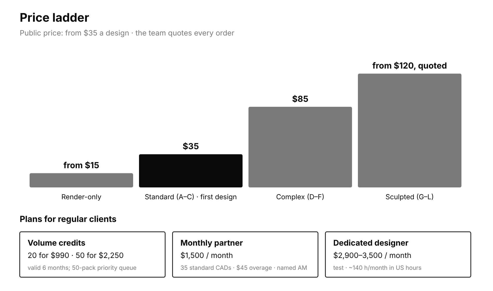

## 6.2 Plans for regular clients

| Plan | Price | Includes |
| --- | --- | --- |
| Volume credits | 20 for $990 · 50 for $2,250 | Prepaid; valid 6 months; same guarantees; the 50-pack gets the priority queue |
| Monthly partner | $1,500 / month | 35 standard CADs; overage $45; named account manager; monthly report |
| Dedicated designer | $2,900–3,500 / month (being tested) | One dedicated designer, about 140 hours a month in US hours, second-designer QC |

Plans are sold manually by the Client Acquisition Lead until checkout for plans is switched on in the portal **[TBC: date]**.

> **Rule:** do not pitch credits or the partner plan as cheaper per design than Standard work until Fazil confirms which categories a credit covers **[TBC]** (Appendix G). Pitch them for what they give: a priority queue, a named account manager, a monthly report, predictable capacity.

## 6.3 Revisions

- **2 revision rounds** are included, **within 14 days of first look**.
- After that, changes are a new job at their own category.
- **Our errors are fixed free and first.** A send-back from our own QC is not a client revision.
- **New scope is a new quote.** "Make it a pendant instead of a ring" is new work.

## 6.4 The guarantee: castable to spec

> **Say this:** "Castable files, guaranteed to spec. Every delivery comes with a signed spec sheet. If the file breaks its own spec sheet, we fix it free and refund the CAD fee."

**What the spec sheet records:** minimum wall, prong and stone-seat sizes, the ring size, the mesh tolerance, and that there are no open edges.

**Not covered:**

- casting failures where the archived file meets its spec (we do not control the caster);
- edited files (the fingerprint does not match the archived file);
- anything the client waived on the spec sheet;
- claims made more than 30 days after delivery.

**The limit:** liability is capped at the CAD fee, never metal or stones. More than 2 claims a quarter from one client go to manual review.

**Explain the difference simply.** The guarantee is about **our file**, not the **casting**:

> **Say this:** "We guarantee the file. If the file meets the spec on its certificate, it's castable. If the casting fails because of the metal, the temperature or the process, that's the caster's side, and we can't control it. If our file broke the spec, we fix it and refund the CAD fee."

> **Never say this:** "Guaranteed to cast." "We cover the metal." "Any problem, full refund."

## 6.5 The 6-hour promise

See Module 5.4. First look within 6 hours of order confirmation for categories A–F, or the full amount is credited and the work is still completed. Complex work has a firm deadline stated with the price.

## 6.6 Payment

- **Prepaid.** The client pays before work starts: by card in the portal, or by bank transfer, Wise or PayPal, which finance confirms. Credits and plans are paid in advance.
- **No net-30** before a client has 3 months of history.
- Every paid order gets an invoice automatically.

## 6.7 Cancellations and refunds

| When | What happens |
| --- | --- |
| Before payment | Cancel or decline at no cost. |
| Paid, not yet confirmed | Full refund on request (the client messages the team). |
| Confirmed (a designer is working) | No refund for a change of mind. The 2 revision rounds apply; a real problem is reworked or refunded. |
| Late first look / spec claim | As in 5.4 and 6.4. |

## 6.8 IP and confidentiality

- **NDA by default.** No separate document is needed to start.
- **The client owns the IP** once the order is paid in full.
- **No portfolio use** without the client's written consent.
- **Files are kept 12 months**, then archived. A client can ask for deletion.
- **White-label:** nothing carries TCP branding unless the client asks.
- **Double-blind:** designers never see the client's customer, store name or contact.

## 6.9 Approval

The client approves or asks for changes within 5 business days, after which the order is auto-approved **[TBC: confirm this is still the policy]**. Until confirmed, tell clients: "Please approve or send changes within a few days so we can close the order."

## 6.10 Free work

- **No free samples by default.** Jewellers will not send real briefs to strangers (IP fear), portfolios and renders are distrusted, and free work signals low value.
- **Our trust tool is risk reversal:** a small prepaid first order, two-stage QC, approval before final release, the 6-hour credit and the spec guarantee.
- **Only Fazil** may approve a free first design, and only for a top-tier anchor account with a strong trigger.

## 6.11 What is not included

- Rush delivery.
- Unlimited revisions.
- Casting, printing, metal or stones.
- Metal cost on the weight sheet (grams only).
- Net-30 for new clients.
- Dental or watch CAD.

> **Key takeaways**
> - Public price: from $35 a design. The team quotes; you never do.
> - 2 revision rounds within 14 days of first look; our errors fixed free and first.
> - We guarantee the file to spec, not the casting outcome. Liability is capped at the CAD fee.
> - Prepaid, no net-30 before 3 months, no free samples without Fazil.

**Quiz — Module 6**

1. A client asks "How much is a halo ring?" What do you say?
2. Explain the difference between "castable to spec" and "guaranteed to cast" in two sentences.
3. List the four things the spec guarantee does not cover.
4. A client paid but the order is not yet confirmed and they want to cancel. What happens?
5. Who can approve a free first design, and for whom?
# Module 7 — Competitive landscape and battlecards

**Learning goal:** know who else the client could use, why they leave suppliers, and how we win or lose against each type.

## 7.1 The market at a glance (69-company study, October 2026)

- The median published B2B entry price is about **$33**.
- Offshore studios price between **$12 and $49**. Western trade studios start at **$58+**.
- Stuller charges **$99** to submit a CAD and **$149** to modify a style, with about a **10-day** custom turnaround.
- The fastest advertised turnaround is **24 hours**. **No competitor guarantees turnaround with a refund.** Almost none guarantee castability.

At $35 we sit at the market median, with guarantees nobody else offers. **Sell on proof, not on price.**

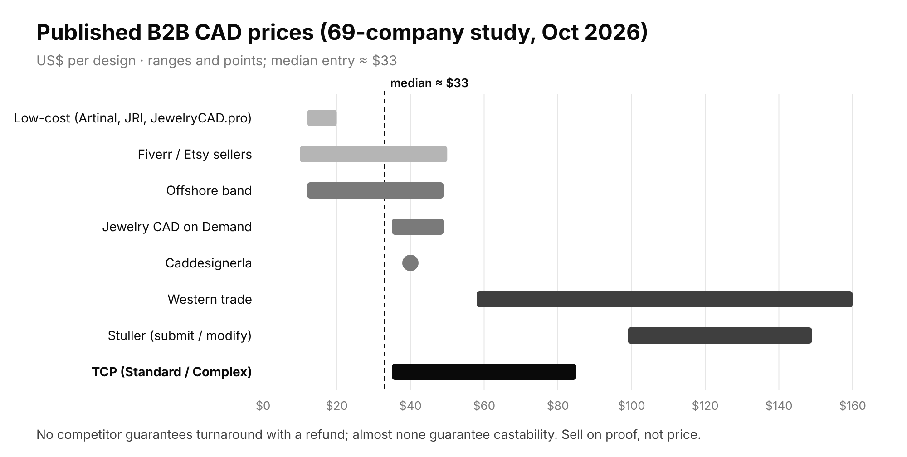

## 7.2 What buyers value, and why they leave

| Buyers value most (in order) | Why they leave a supplier |
| --- | --- |
| 1. Castable, bench-correct files | Failed casting or a wrong stone seat |
| 2. The brief right the first time | Repeated brief misses |
| 3. Speed and predictable timelines | Missed deadlines |
| 4. A clear price before work | Surprise revision charges |
| 5. Responsive communication | (Slow or no answers) |

Every battlecard below comes back to these five.

## 7.3 The five competitor types

| Type | Examples | Their strength | Our edge |
| --- | --- | --- | --- |
| Direct offshore studios | Jewelry CAD on Demand (Mumbai), Caddesignerla (LA), Jewel CAD Designer, Sarkissian, 3D Jewelry Pro, The CAD Co. | Low price, some fast | Guaranteed turnaround with a credit, spec guarantee, portal, two-stage QC |
| Premium and trade | Stuller, 247CadControl, The CAD Maker, Empire Casting House, White Pine | Brand trust, bundled with casting | Speed (6 hours vs days), clear prices, white-label |
| Low-cost | Artinal, Jewelry Renderings India, JewelryCAD.pro, Fiverr/Etsy sellers | Price ($10–50) | Consistent quality, accountability, a guarantee |
| DIY and AI tools | MatrixGold/CounterSketch, Pencil, NimoraAI, Meshy | No per-job fee; instant for simple pieces | Complex pieces, manufacturability checks, no learning curve |
| In-house or local | A US in-house hire (about $31/hour), local trade shops | Control, same room | No salary, capacity on demand, US-hours speed |

## 7.4 Battlecards

**Jewelry CAD on Demand (Mumbai).** $35 simple / $49 complex, including 4 renders and all changes; 24–72 hours; email only.

- *Where they win:* "all changes included", 4 renders, low complex price.
- *Where we win:* a guaranteed first look with a credit; spec guarantee; a portal with history and reorders; a two-stage QC record on every file.
- *Landmine to set:* "When a revision takes three days, what does that cost you with your customer? What happens if a file doesn't cast?"
- *Never say:* anything negative about them. Compare what is published.

**Caddesignerla (LA).** $40 flat, 24 hours, 3 revisions.

- *Where they win:* simple flat price, 24 hours, one more revision round than us.
- *Where we win:* 6 hours for standard work, guaranteed with a credit; spec guarantee; the deliverables pack (technical sheet, weight sheet, QC certificate, preview link).
- *Landmine:* "Is the 24 hours guaranteed? What happens if they miss it?"

**Stuller.** $99 submit / $149 modify a style; about 10 days for custom.

- *Where they win:* 55+ years, a trusted brand, everything in one place.
- *Where we win:* first look in 6 hours instead of days; prices from $35; white-label.
- *Landmine:* "How many custom sales do you lose while a customer waits 10 days?"

**247CadControl (UK).** Trade-only hub, under 48 hours, video renders, CAD fee waived with manufacturing.

- *Where they win:* bundled with manufacturing; video renders.
- *Where we win:* the client can cast anywhere; guaranteed 6-hour first look for standard work; spec guarantee.
- *Landmine:* "Are you tied to their casting to get the CAD free?"

**Low-cost sellers (Artinal $12, Jewelry Renderings India $12, JewelryCAD.pro from $20, Fiverr/Etsy $10–50).**

- *Where they win:* price.
- *Where we win:* accountability. A named process, a signed spec sheet, a refund if the file breaks spec.
- *Landmine:* "What did the last failed casting cost you in metal and time?"

**AI tools (Pencil and others).**

- *Where they win:* simple parametric rings, instantly.
- *Where we win:* complex and sculpted pieces, manufacturability checks by people, and nobody on their team has to learn software.
- *Say:* "Use AI for the simple bands if it works for you. Send us the pieces that have to be right."

**An in-house hire.**

- *Where they win:* control.
- *Where we win:* no salary, no hiring gap, capacity when the rush comes. "A designer when you need one, not a salary."

## 7.5 How we lose (and what to do)

| We lose when… | What to do |
| --- | --- |
| The buyer wants the lowest price only | Do not discount. Thank them; offer to be the backup for complex or urgent work. |
| CAD is bundled free with their casting supplier | Position as overflow and speed for jobs that cannot wait. |
| The buyer needs unlimited revisions | Explain what is included; escalate if it is a large account. Never offer unlimited revisions. |
| The buyer will not prepay | Explain prepaid terms and no net-30 before 3 months. Escalate large accounts. |
| We over-promise and miss | Never over-promise. Use only the wording in Modules 5 and 6. |

> **Key takeaways**
> - At $35 we are at the market median; we win on guarantees and process, not price.
> - Buyers leave over failed castings, brief misses, missed deadlines and surprise charges. Our offer answers each one.
> - Compare what is published; never run a competitor down.

**Quiz — Module 7**

1. What is the median published B2B entry price, and where does $35 sit against it?
2. Name the five things buyers value most, in order.
3. What do no competitors offer with their turnaround?
4. A prospect says "Stuller is safer." What is your landmine question?
5. How do you position against AI tools?

# Module 8 — Prospecting

**Learning goal:** build a clean list of real buyers with real signals, in 8 minutes a lead or less, and record them correctly.

## 8.1 Where leads come from

> **Rule:** prospect data comes from **public business information only**: the business's own website, its Google Maps listing, public social profiles and directories. You find and type it by hand. No scraping tools, no automated collection, no bought or rented lists, never anything from a previous employer. Use only contact details the business publishes. Never guess an email.

**The lead database (v1):** 683 de-duplicated companies (Canada 292, UK 208, USA 86, UAE 51, Saudi Arabia 40, Australia 6), 476 of them verified in official registers or government records. Websites and emails are still to be added. **[TBC: confirm the database was collected in line with the rule above before use.]**

**Growing toward 10,000:** the November plan listed the Companies House bulk file, the JCK 2026 exhibitor list, the MJSA Buyer's Guide, the ABN bulk extract and Gulf trade-show lists. Bought lists and automated bulk collection conflict with the rule above, so **do not use any of these until Fazil confirms in writing [TBC]**. Official registers may be used to *verify* a company you found by hand.

## 8.2 The research routine (8 minutes or less per lead)

1. **Find the company** (Google Maps, a directory, a trade-show page, a public profile). 1 minute.
2. **Check the CRM** for the company domain. If it is there, stop: it belongs to whoever logged it (8.5). 30 seconds.
3. **Confirm the segment and fit** on the website: what they make, custom work, size. 2 minutes.
4. **Find the signal** (Module 4.3): a job ad, a backlog post, a new collection, a custom page. Grade it (8.3). 2 minutes.
5. **Find the decision-maker** and their published email. Never guess an email. 1–2 minutes.
6. **Verify the email** with the verification tool. 30 seconds.
7. **Log it** in the CRM with every column filled. 1 minute.

If you cannot find a real signal in the time, log the lead as grade C and move on.

## 8.3 Signal grades

| Grade | What it is | Example | Month 1 |
| --- | --- | --- | --- |
| **A** | A CAD job ad or a public post about a custom backlog | "Hiring: Rhino/Matrix designer" | Yes |
| **B** | A new collection, a new store, or a custom page pushed | "New bridal collection launching March" | Yes |
| **C** | A custom page only, nothing current | "We do custom" on the site | No |

In month 1, contact A and B only.

## 8.4 Personalization levels

| Level | Used for | Time | What you write |
| --- | --- | --- | --- |
| **L1** | Grade C (later months) | Seconds | Segment-level message |
| **L2** | Grade B | About 1 minute | One true line about them |
| **L3** | Grade A | 3–5 minutes | The trigger, in their words |
| **L4** | The top ~50 anchor accounts | 20–40 minutes | A piece modelled in their style; Fazil sends it |

> **Rule:** the personal line must be **true and checkable**. If you cannot find one, drop a level. Never fake it.

## 8.5 De-duplication, ownership and suppression

- **Ownership is by company domain.** The first person to log a domain owns it.
- **Ownership lapses after 45 days** without contact.
- **Duplicates:** if the domain is already logged, set `Dup_Flag` and do not contact.
- **Suppression:** anyone who asks not to be contacted is marked at once, with the reason, and is never written to again. Set `Suppress_Flag`. They stay on file so nobody re-adds them.

## 8.6 The CRM sheet

| Column | What goes in it |
| --- | --- |
| Owner | You |
| Country | Country of the business |
| Segment | One of the segments in Module 4.1 |
| Company | Trading name |
| Company_Domain | Website domain (the ownership key) |
| Contact | Decision-maker's name |
| Email | Published email only |
| Source_URL | Where you found the email or the business |
| Signal | The trigger, in a few words |
| Signal_Grade | A, B or C |
| Verify_Status | Result of the email check |
| Sending_Inbox | Which outreach inbox sends to them |
| Step_Sent | Last sequence step sent |
| Replied | Yes / No |
| Reply_Type | Interested, objection, later, not interested, opt-out |
| Qualified_Date | Date they passed the 4 qualifying questions |
| Quote_Sent | Date the team sent a quote |
| Paid_Customer | Yes / No |
| First_Order_Date | Date of the first paid order |
| Designs_Ordered | Running count |
| Revenue_USD | Running total |
| Next_Action | The one next thing |
| Next_Date | When |
| Dup_Flag | Set if the domain is already owned |
| Suppress_Flag | Set if they opted out |

> **Key takeaways**
> - Public sources, typed by hand, published emails only. Never guess, never buy lists until Fazil says so.
> - 8 minutes a lead, A and B signals only in month 1.
> - The domain decides ownership; opt-outs are permanent.

**Quiz — Module 8**

1. List the seven steps of the research routine.
2. What is the difference between an A, a B and a C signal?
3. Who owns a company already in the CRM, and when does that lapse?
4. What do you do when you cannot find a true personal line?
5. Why must you not use the JCK exhibitor list yet?
# Module 9 — Outreach playbook

**Learning goal:** send messages that get replies, without damaging our domains or breaking the law.

## 9.1 The sending setup

- **Mailboxes:** Google Workspace Business Base (12 mailboxes).
- **Sending tool:** Smartlead Base. **Email check:** MillionVerifier. **CRM:** one Google Sheet.
- **Domains:** 3 branded outreach .com domains, 3 inboxes each, all redirecting to thecadpillar.com.
- **The main domain thecadpillar.com never sends cold email.**
- **Settings:** warm-up pools OFF (no fake conversations), open and link tracking OFF, stop-on-reply ON.
- **Team:** the Founder/admin; the **Client Acquisition Lead** (runs Smartlead, closes deals, owns paid and repeat accounts, shares orders@ by delegation); and **3 prospecting reps** by market and India-time shift:

| Rep | Market | Shift (IST) |
| --- | --- | --- |
| Rep 1 | USA | 14:00–23:00 |
| Rep 2 | UK / EU | 12:30–21:30 |
| Rep 3 | Australia | 07:00–16:00 |

Each rep owns one inbox on each outreach domain, under their **real name only**.

## 9.2 Email rules

1. **120 words or fewer.** Plain text.
2. **One call to action.** The ask is a **first brief**, not a meeting.
3. **No link in email 1**, except in the signature.
4. **Signature:** real name, title, Ichizu Private Limited postal address, and an opt-out line.
5. Every first email says **how to opt out**. Anything in [square brackets] is replaced with a real detail before sending.
6. **Calls only** for accounts that could do 20 or more designs a month.

## 9.3 Sequences

> **Rule:** a sequence is **three messages: day 1, day 4 and day 10**, and never more unless the person replies. Stop-on-reply is always on.

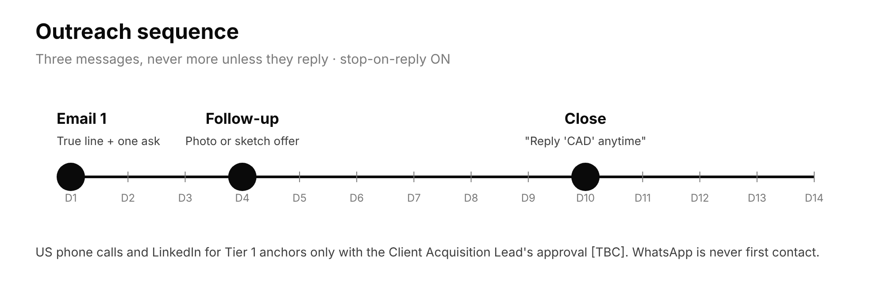

**ICP1 — custom and bridal retailers (US English)**

Email 1, day 1:

```
Subject: custom orders at {Store}

Hi {First},

I saw {true line, e.g. "your custom bridal page says designs take 2 weeks"}.

We're The CAD Pillar, a CAD studio for jewelry stores. Send us a sketch or photo and you get a first look within 6 hours of order confirmation, so your customer sees their ring while they're still excited. Every file comes with a spec sheet and is castable to spec, guaranteed.

Want me to quote one custom job you have open?

{Name}, {Title}
The CAD Pillar · Ichizu Private Limited · {postal address}
Not relevant? Reply "no" and I won't write again.
```

Follow-up, day 4:

```
Subject: re: custom orders at {Store}

Hi {First},

Simple offer: reply with a photo or sketch of any piece you've delayed, and I'll send a price and a delivery time the same day.

{Name}
```

Close, day 10:

```
Subject: re: custom orders at {Store}

Hi {First},

I'll close your file for now. If a custom job ever gets stuck, reply "CAD" and I'll pick it up.

{Name}
```

**ICP2 — brands and manufacturers (US English)**

Email 1, day 1:

```
Subject: {Collection} CAD

Hi {First},

{True line, e.g. "Congrats on the spring bridal line announced last week."}

When launches stack up, CAD is usually the bottleneck. We're The CAD Pillar, an on-demand CAD department: 3DM and STL with a render and a signed spec sheet, white-label, under NDA, and you own the files once paid. Standard pieces get a first look within 6 hours of order confirmation.

Worth sending one piece from your next drop?

{Name}, {Title}
The CAD Pillar · Ichizu Private Limited · {postal address}
Not for you? Reply "no" and I'll stop.
```

Follow-up, day 4: "Easiest test: send one piece you'd normally give your own CAD team. You'll have a price before any work starts."

Close, day 10: "I'll leave it here. Reply 'later' and I'll check back before {season}."

**Tier 1 anchors (casting houses, manufacturers).** The ask is "Send me 3 backlog jobs." The November plan called for 6–8 touches over 3–4 weeks across email, LinkedIn and phone. Until Fazil confirms how the three-message rule applies to phone and LinkedIn **[TBC]**, use the three emails (day 1, 4, 10), and add calls and LinkedIn only with the Client Acquisition Lead's approval.

UK and Australian versions of every template are in Appendix C.

## 9.4 Phone and voicemail

Phone is core for US jewellers.

> **Say this (opener):** "Hi {First}, {Name} with The CAD Pillar — we do jewelry CAD for stores and manufacturers. Quick question: when a customer brings in a custom request, how long until you can show them a CAD?"

Then listen. If the answer is "days", the pain is real: go to discovery (Module 10).

> **Say this (voicemail, under 20 seconds):** "Hi {First}, {Name} from The CAD Pillar. We build jewelry CAD for stores, with a first look within 6 hours of order confirmation. I'll send a short email; if you've got a custom job waiting, just reply with a photo. Thanks."

## 9.5 LinkedIn and WhatsApp

- **LinkedIn:** connect with the decision-maker with a short note that uses the same true line. No pitch in the connection request.
- **WhatsApp:** **only after** the prospect shares a number or an order is live. **Never as first contact.** Live support uses the company WhatsApp; you never use a personal number for client work.

## 9.6 Deliverability and the sending ramp

| Inbox age | New prospects per inbox per day |
| --- | --- |
| Days 1–7 | Not set in the plan **[TBC]** |
| Days 8–14 | 5 |
| Days 15–21 | 8 |
| Days 22–30 | 10 |
| Steady state | About 8 |
| Hard cap | 30 total sends per inbox per day (first emails plus follow-ups) |

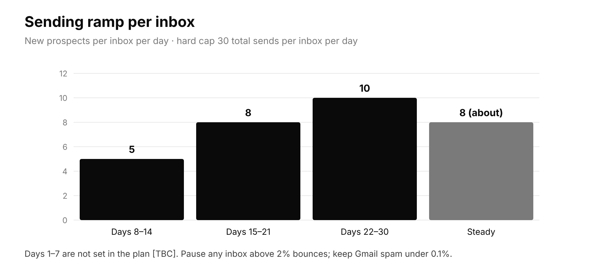

**Health limits:**

- Hard bounces under **1%**. Pause any inbox above **2%** bounces.
- Gmail spam rate under **0.1%**, never **0.3%** or more.
- **December:** retail (ICP1) sends pause **11 December – 4 January**; brands and manufacturers continue until **18 December**.
- Daily prospect standard drops from 25 to **15 in December**.

## 9.7 Reply speed

- Reply to every reply within **2 business hours**; **1 hour** for positive replies.
- Log every reply the same day (`Replied`, `Reply_Type`, `Next_Action`, `Next_Date`).
- Opt-outs: mark `Suppress_Flag` at once.

## 9.8 Compliance by country

| Country | Rule | What you do |
| --- | --- | --- |
| USA | CAN-SPAM | Truthful headers and subject; postal address; honour opt-outs within 10 business days. Penalties up to $53,088 per email. |
| UK | PECR | Email limited companies and LLPs only, never sole traders or partnerships. Add a legitimate-interest note and a privacy link. |
| Germany, Austria | Prior consent needed, even B2B | **Do not cold email.** |
| Other EU | Varies | Only after a legal check. |
| Australia | Spam Act | Only conspicuously published business emails; the message must be relevant to the person's role; no harvested lists; honour opt-outs within 5 business days. |
| Everywhere | Our own rules | Never guess an email. Public or published sources only. Never use a previous employer's data. |

> **Key takeaways**
> - Three messages (day 1, 4, 10), one ask each: a first brief, not a meeting.
> - Never send cold from thecadpillar.com; respect the ramp and the bounce and spam limits.
> - WhatsApp is never first contact.
> - Know the law for the country you send to; Germany and Austria are off-limits for cold email.

**Quiz — Module 9**

1. How many messages are in a sequence, on which days, and when do they stop?
2. List five rules every first email must follow.
3. What is the hard cap on sends per inbox per day, and what is the steady-state number of new prospects?
4. When does retail sending pause in December?
5. Who can you email in the UK under PECR, and who not?

# Module 10 — Discovery and qualification

**Learning goal:** run a short discovery conversation, decide quickly whether a prospect fits, and know when to bring in the founder.

## 10.1 The four qualifying questions

Ask these on every positive reply, by email or on a call:

1. **How many designs or custom jobs do you do a month?**
2. **Who does your CAD today, and what slows it down?**
3. **What software and file formats do you need?**
4. **Who approves a new supplier?**

**Minimum fit:** retailers 5 or more custom pieces a month. A prospect is **qualified** when you have all four answers and they fit. Log `Qualified_Date`.

## 10.2 Call structure (15–20 minutes)

1. **Open (1 minute):** thank them, confirm the time, state the goal: "See if we can take some CAD off your plate, and if so, start with one job."
2. **Discover (8 minutes):** the questions below. Listen more than you talk.
3. **Fit (3 minutes):** play back what you heard; show how we answer their biggest pain.
4. **Risk reversal (2 minutes):** small prepaid first order, two-stage QC, approval before final release, the 6-hour credit, the spec guarantee.
5. **Ask (1 minute):** "What's one piece you'd send first?"
6. **Next step (1 minute):** agree what they send and when. Log it.

## 10.3 Fifteen discovery questions

1. How many custom or CAD jobs do you handle in a typical month?
2. How many in your busiest month?
3. Who does your CAD today: in-house, freelancer, another studio?
4. What slows it down most?
5. How long does a customer wait to see a CAD today?
6. What happened the last time a file failed at casting or setting?
7. What software do you or your caster use? 3DM, STL, both?
8. Do you cast in-house or with a caster? Print in-house?
9. Do you need renders for your customers or your website?
10. Which metals and karats do you use most?
11. What sizing system do your customers use?
12. Do you have standing rules every CAD must follow (wall thickness, prong style, finishing)?
13. What launches, shows or seasons are coming up?
14. Who else needs to approve a new supplier?
15. If we did one job well, what would the next ten look like?

## 10.4 Fit scoring

Score each line 0, 1 or 2 and add them up. This is a guide for your judgement, not a rule.

| Factor | 0 | 1 | 2 |
| --- | --- | --- | --- |
| Segment tier | Tier 3 | Tier 2 | Tier 1 |
| Monthly volume | Below minimum fit | Minimum fit to 19 a month | 20+ a month |
| Pain | None stated | Some delay | Clear backlog or lost sales |
| Access | Junior contact | Influencer | Decision-maker |
| Signal | C | B | A |

| Total | What you do |
| --- | --- |
| 8–10 | Priority. Book a call; involve the Client Acquisition Lead. If 20+ a month, consider L4 treatment. |
| 5–7 | Normal. Aim for a first paid order. |
| 0–4 | Low. Answer politely; no chasing. |

## 10.5 When to escalate to the founder

| Situation | Escalate to |
| --- | --- |
| An account that could do 20+ designs a month | Client Acquisition Lead, then Fazil |
| A request for a free first design | Fazil (only he can approve) |
| A request for net-30, a discount, exclusivity or unlimited revisions | Client Acquisition Lead |
| A guarantee or SLA claim, or a complaint | Client Acquisition Lead, same day |
| Legal, contract or data-protection questions | Fazil |
| Anything you do not know the answer to | Client Acquisition Lead |

> **Key takeaways**
> - Four questions decide fit: volume, current CAD and its pain, formats, the approver.
> - On calls, listen first; end every call with one piece and one date.
> - Escalate big accounts, free-work requests and any exception.

**Quiz — Module 10**

1. Recite the four qualifying questions.
2. What is the minimum fit for a retailer?
3. List the six parts of a discovery call.
4. A prospect scores 9 on fit and could do 30 designs a month. What do you do?
5. Who can approve a free first design?
# Module 11 — Guiding the client to the first order

**Learning goal:** turn a positive reply into a paid, confirmed first order with a complete brief, and recover well if the first look is not right.

## 11.1 The path to the first order

1. **Reply within 1 hour** to a positive reply.
2. **Qualify** with the four questions (Module 10).
3. **Get one real job.** "Send one sketch or photo with the size and metal."
4. **Coach the brief** until it is complete (11.2).
5. **Set expectations** (11.4).
6. **Onboard to the portal:** sign-up and verification, or an order created on their behalf from WhatsApp or email (11.5).
7. **The team quotes; the client pays; the team confirms.** The 6-hour clock starts.
8. **First look within 6 hours** (standard work).
9. **Approval**, then the credits offer the same day (Module 13).

## 11.2 Brief coaching

Use the seven-item list from Module 2.5. Ask for everything in one message so the client answers once.

> **Say this:** "To get you a first look fast, can you send these in one go: the ring size and which country's sizing, the metal and karat, the centre stone shape and size, any side stones, the setting style, a photo or sketch, and whether you'll cast or print it?"

**Common gaps and how to close them:**

| Gap | Ask |
| --- | --- |
| Size without a system | "Is that a US size or a UK size?" |
| "Gold" | "Which karat and colour: 14K yellow, 18K white …?" |
| Stones "like the photo" | "What size is the centre stone, in millimetres or carats? And the side stones?" |
| No setting style | "Prongs, bezel or pavé? How many prongs?" |
| No manufacturing info | "Will you cast it, or print directly? Anything your caster needs?" |
| Standing preferences | "Do you have rules every design should follow? You can save them once as master instructions on your account." |

## 11.3 Sizing by country

Always record the size **and** the system (Module 2.4). US and Canadian clients use numbers, UK and Australian clients use letters, European clients use millimetres of circumference. If unsure, ask for the inside diameter in millimetres.

## 11.4 Setting expectations

Say these clearly before they pay:

- "The team will send the price in the portal before any work starts."
- "Once it's paid and we've confirmed the brief, you'll have a first look within 6 hours" (standard work), or "by {deadline stated with the price}" (complex work).
- "You get two rounds of changes within 14 days of the first look. Anything we got wrong, we fix free and first."
- "You'll receive the 3DM and STL, a render, a technical sheet, the QC certificate, which is also your spec sheet, a weight sheet, a summary sheet and a preview link."
- "We guarantee the file to its spec sheet. We can't guarantee the casting itself, because we don't control the caster."

## 11.5 The risk-reversal pitch

When a prospect hesitates, do not discount. Lower the risk instead:

> **Say this:** "Here's why the first job is low-risk. It's one small prepaid order. Two people check the file before you see it. Nothing is final until you approve it. If a standard first look is late, the full amount is credited. And if the file breaks its own spec sheet, we fix it and refund the CAD fee."

## 11.6 Portal onboarding

1. **Sign-up:** the client creates an account and completes verification: name, business, business type, country, address, website or Instagram, and at least one proof of business registration. An admin approves it **[TBC: typical approval time]**.
2. **Account:** add business details and, if they have them, **master instructions** (their standing rules for every design).
3. **First order:** the one-page brief on desktop. The form will not submit without the minimum: product type, a reference image, size, metal, and the centre stone (yes or no, and its shape and size).
4. **Pay** the quote by card in the portal, or by bank transfer, Wise or PayPal and press "I've paid".
5. **Messages:** every question about the order goes in its thread, so nothing is lost.

**Prefer WhatsApp or email?** The team can create the order for them from a screenshot. It still appears in their portal, and the 6-hour clock still starts at payment plus confirmation.

## 11.7 If the first look is wrong

The first order is the one most likely to need changes: we do not know the client's style yet.

1. **Respond within 1 hour.** Thank them for the detail.
2. **Separate our error from new scope.** Our error (the file does not match the brief) is fixed free and first. A new idea is a revision round (2 included) or new scope (a new quote).
3. **Get the change in one list.** "Can you mark everything you'd like changed in one message? Drawing on the image helps."
4. **Tell them when.** Ask the team for the time and pass it on; never guess.
5. **Capture the lesson.** Suggest they save standing preferences as master instructions so the next job is right first time.
6. **If it was late:** for standard work, the system raises a credit for the full amount paid, once, and the team confirms it (applied to the next order or refunded). Acknowledge it plainly: "That first look was late, so the full amount will be credited to you. The team will confirm it, and the work continues as normal."

> **Never say this:** "The designer messed up." Clients deal with TCP, not with designers. Say "We missed that, and we're fixing it now."

> **Key takeaways**
> - One real job, a complete brief, clear expectations, then payment and confirmation.
> - Lower risk; never lower the price.
> - On a wrong first look: answer fast, separate error from new scope, fix our errors free and first.

**Quiz — Module 11**

1. List the nine steps from a positive reply to approval.
2. A client writes "make it in gold like the photo". What three questions do you ask?
3. What five things do you say to set expectations before payment?
4. Give the risk-reversal pitch in your own words.
5. The client says the first look misses the brief. What are your first three actions?

# Module 12 — Objection handling

**Learning goal:** answer the objections you will hear every week with honest replies, a real proof point and a next step.

**How to answer any objection:** (1) acknowledge it, (2) find out what they really mean, (3) answer with a fact from this document, (4) give a proof point we can stand behind, (5) ask for the next step. **Never invent a proof point.** We have no testimonials, logos or published statistics yet.

| # | Objection | What they mean | Reply | Proof point | Next step |
| --- | --- | --- | --- | --- | --- |
| 1 | "How do I know my designs are safe?" | IP fear | "Everything is under NDA by default, you own the files once paid, and we never use your work in a portfolio without written consent." | NDA by default; IP transfers on payment; no portfolio use without consent; double-blind working | "Send one piece you're comfortable with first." |
| 2 | "Will your designers contact my customer?" | Fear of being cut out | "No. Designers never see your customer, your store name or your contacts, and everything is white-label." | Double-blind; white-label by default | "Want to try one job?" |
| 3 | "India? I'm worried about quality." | Bad past experience offshore | "Fair concern. Every file is checked by the designer and then by a second person against a written checklist, and you get the signed spec sheet. If the file breaks that spec, we fix it free and refund the CAD fee." | Two-stage QC; spec guarantee | "Judge us on one real job." |
| 4 | "Time zones will slow things down." | Fear of waiting overnight | "Our team works through US business hours. That's how standard work gets a first look within 6 hours of order confirmation." | 6-hour promise with credit | "Send it in the morning and see." |
| 5 | "You're too expensive." | Comparing to $10–20 sellers | "We're at the market median, from $35 a design. The difference is that we guarantee the turnaround and the file. What did the last failed casting cost you?" | Market median ~$33 (study); guarantees | "Compare one job side by side." |
| 6 | "We have an in-house CAD designer." | No need | "Great. We're the overflow for busy weeks so they never become the bottleneck." | Capacity on demand | "Keep us as backup with one test job?" |
| 7 | "Send a free sample first." | Wants risk-free proof | "We don't do free samples: most jewellers don't want to send real designs to someone new. Instead, the first job is small and prepaid, nothing is final until you approve it, and the guarantees apply." | Risk reversal; approval before release | "Which piece would you send?" (Escalate to Fazil only for a top-tier anchor.) |
| 8 | "We already have a CAD supplier." | Switching is a hassle | "Most of our clients keep their supplier. Be the second option and compare one job side by side." | Turnaround guarantee nobody else offers | "What's one job you'd test?" |
| 9 | "Is paying you online safe?" | Payment security | "You pay through the card checkout in our portal or by bank transfer, and every paid order gets an invoice." | Card checkout; automatic invoices | "Want me to walk you through the portal?" |
| 10 | "Who owns the files?" | IP | "You do, once the order is paid in full." | IP transfers on payment | "Shall we start with one?" |
| 11 | "AI can do this now." | Price pressure from tools | "For simple bands, it might. For halos, pavé and sculpted pieces that have to cast first time, you want people checking every file." | Two-stage QC; complex work | "Send us the piece AI can't do." |
| 12 | "Stuller is cheaper / safer." | Brand trust | "Stuller is a great company. Their custom CAD is $99–149 and about 10 days. Ours is from $35 with a first look in 6 hours for standard work, guaranteed." | Published Stuller prices (study) | "Try one job against them." |
| 13 | "What if it doesn't cast?" | Fear of loss | "We guarantee the file to its spec sheet. If our file broke the spec, we fix it and refund the CAD fee. If the file met spec and the casting failed, that's the casting process, which we can't control." | Spec guarantee; fingerprinted archive | "Send one and check the spec sheet yourself." |
| 14 | "We need unlimited revisions." | Fear of being charged | "Two rounds within 14 days are included, and our errors are always fixed free and first. New ideas beyond that are quoted, so there are no surprises." | Revisions policy | "Most jobs finish in one round. Shall we start?" |
| 15 | "Can we pay net-30?" | Cash flow | "We work prepaid until we've worked together for 3 months." | Policy | "Credits spread the cost; want details?" (Escalate large accounts.) |
| 16 | "Where are you based?" | Trust | "Our studio is in New Delhi. The team works US business hours, which is how we deliver a first look within 6 hours." | 6-hour promise | "Want to test it with one job?" |
| 17 | "We're too busy right now." | Timing | "That's exactly when we help. Send one job you'd otherwise push to next week." | Capacity | "What's stuck right now?" |
| 18 | "Send me your portfolio." | Wants proof | "Our work is white-label and under NDA, so we don't show clients' pieces. The best proof is one of your own jobs, checked twice and guaranteed to spec." | NDA; white-label | "Which piece would you send?" |
| 19 | "How many designers do you have?" | Capacity worry | "Senior western-jewellery CAD designers, with every file checked by a second person. Tell me your monthly volume and I'll confirm we can hold capacity for you." | Two-stage QC | Escalate volume questions to the Client Acquisition Lead. |
| 20 | "Can I talk to my designer directly?" | Control | "You deal with us, and we handle the designer, so you have one point of contact and your customer stays private. Every message goes in the order's thread." | Double-blind; per-order threads | "Want me to set up your account?" |
| 21 | "Your 6 hours — from when?" | Testing the promise | "From when the order is paid and we've confirmed the brief. A complete brief means we confirm faster." | Clock rule | "Shall I send the brief checklist?" |
| 22 | "Do you do rush?" | Urgency | "Not as a separate service. Standard work is already a first look within 6 hours of order confirmation." | 6-hour promise | "What's the deadline?" |
| 23 | "Can you match {competitor}'s price?" | Discount request | "We don't discount beyond the first step. We'd rather show you the difference on one job." | Never offer discounts beyond the first step | "Which job shall we test?" |

> **Never say this:** "50+ designers with 10+ years each." "99% right first time." "We've done thousands of rings." "Our clients include …" None of these can be proven today.

> **Key takeaways**
> - Acknowledge, clarify, answer with a fact, give a real proof point, ask for the next step.
> - Lower risk instead of lowering price.
> - Never invent proof: no testimonials, logos or statistics exist yet.

**Quiz — Module 12**

1. What are the five steps for answering any objection?
2. How do you answer "Send a free sample first"?
3. How do you answer "What if it doesn't cast?" without over-promising?
4. A prospect asks how many designers we have. What do you say, and what must you never say?
5. A prospect asks you to match a $12 price. What do you do?
# Module 13 — Account management and growth

**Learning goal:** turn a first order into a repeat account and grow it into a plan, while watching for churn.

## 13.1 From first order to plan

1. **First order** (from $35 a design).
2. **First look** within 6 hours of order confirmation (standard work).
3. **Approval.**
4. **The same day:** offer credits and ask for the next job.
5. **3 or more orders = a repeat account.**
6. **Kickoff:** review 5–10 of their approved designs, write style sheet v1 (saved as master instructions), and set a dedicated designer plus a backup on our side.
7. **Day-30 review:** on-time %, revision rounds, what to improve.
8. **A larger plan:** monthly partner or dedicated designer.

**About "named designer".** Under double-blind working, clients never see designer identities. "Dedicated designer" means the same designer works their jobs, with a backup. Whether a client on the dedicated-designer plan learns the designer's name is **[TBC]**. Until confirmed, never share a designer's name.

## 13.2 Check-ins

| When | What | Channel |
| --- | --- | --- |
| Approval of first order | Thank them; offer credits; ask for the next job | Order thread or email |
| Day 7 after first order | "Anything to change in how we work?" | Email |
| Third order | Propose the kickoff (13.1 step 6) | Call for 20+/month accounts; else email |
| Day 30 | Review: on-time %, revisions, what to improve | Call or email |
| Before their season or launch | "Shall we hold capacity?" | Email |

## 13.3 Upsell paths

| Signal | Offer |
| --- | --- |
| 3+ orders in a month | Volume credits (20 for $990, 50 for $2,250; the 50-pack gets the priority queue) |
| Steady monthly volume | Monthly partner ($1,500/month: 35 standard CADs, $45 overage, named account manager, monthly report) |
| Near full-time need, US hours | Dedicated designer ($2,900–3,500/month, being tested) |
| Renders for their website | Render-only orders, from $15 a design |
| Files from other suppliers that fail | CAD file repair, quoted after review |
| Gold price pressure | Redesigns and metal-lightening changes |

Plans are sold by the Client Acquisition Lead (Module 6.2). Do not present credits as cheaper per design than Standard work until confirmed **[TBC]**.

## 13.4 Referrals

- **Channel partners** are the biggest referral source: a casting house or CAD studio that white-labels our work brings its retailers' volume. Ask every Tier 1 client: "Do your retail customers ask you for CAD?"
- Any referral reward is **[TBC]**. Do not promise one.

## 13.5 Churn signals

| Signal | What to do the same day |
| --- | --- |
| A late first look | Acknowledge; confirm the credit is raised; ask what we can improve |
| A revision for our error | Fix free and first; capture the rule in master instructions |
| A casting complaint | Check against the spec sheet with the team; explain spec vs casting (Module 6.4) |
| A surprise charge complaint | Explain the quote and revision rules; escalate if unclear |
| No order for twice their usual gap | Check in: "Anything coming up we can take off your plate?" |
| Slow or short replies | Ask directly: "Is there anything we should do differently?" |

## 13.6 Win-back

- **After a lost client:** "I'll close your file. Reply 'CAD' anytime." Then one check-in before their next season.
- **After a complaint:** fix the root cause first; then offer one job to show the change.
- Never offer a discount beyond the first step to win someone back.

> **Key takeaways**
> - Offer credits on the day of the first approval.
> - Three orders make a repeat account: run a kickoff and a day-30 review.
> - Channel partners are the best referral source.
> - Act on churn signals the same day.

**Quiz — Module 13**

1. When do you offer credits for the first time?
2. What happens at a kickoff?
3. What does "dedicated designer" mean under double-blind working?
4. Name four churn signals and your response to each.
5. What do you ask every Tier 1 client to find referrals?

# Module 14 — Targets, metrics and daily routine

**Learning goal:** know the company targets and the outbound targets (kept separate), what you control, and how to run your day.

## 14.1 Company targets (Model Validation, all E/A)

| Target | Number | Label |
| --- | --- | --- |
| Year-1 collected revenue | ~$287k | E |
| Exit run-rate | ~$660k by October 2027 | E |
| $1M run-rate | ~mid-2028 | E |
| First orders needed | ~310 | E |
| Active accounts needed | ~102 | E |
| Annual churn | ~30% | A |
| First order → repeat | 40–60% | A |
| Cold outbound: researched prospect → active client | 0.3–1% | E |
| Held meetings with fit buyers → close | 20–30% | E |
| Benchmark: median cold-email meeting rate | 0.34% | V |

**The $1M account mix (E, Model Validation).** The model's per-design prices were set before the $35 Standard price was decided (Appendix F).

| Accounts | Designs / month each | Price | Type |
| --- | --- | --- | --- |
| 57 | 5 | $85 | Custom retailers |
| 16 | 15 | $60 | DTC brands |
| 6 | 60 | $42 | Channel partners |
| 12 | 15 | $50 | Small manufacturers |
| 3 | 40 | $38 | Mid manufacturers (overflow) |
| 8 | 8 | $55 | Wholesalers |

About 102 accounts and ~1,249 jobs a month at ~$57 blended, plus render programmes, ≈ $83.5k a month ≈ $1.0M a year (E).

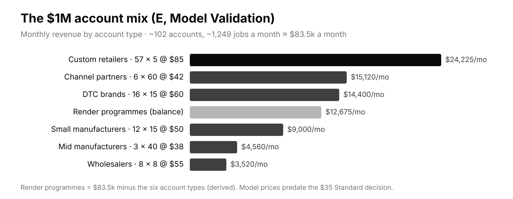

## 14.2 Outbound channel targets (November plan, base case, all A)

| Step | Rate | Per month (team) |
| --- | --- | --- |
| Prospects contacted (from January 2027) | — | 1,500 |
| Positive replies | 2% | 30 |
| Qualified | 60% of positive | 18 |
| Paying | 35% of qualified | ≈ 6 new customers |

By May 2027: about 15 active repeat accounts and ≈ $4.9k a month from this channel (A); floor ≈ $349 a month (A).

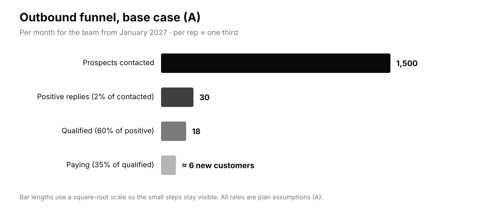

**Your share (A, derived):** 1,500 prospects a month across 3 reps is 500 each, about 25 a working day. At the plan's rates that is about 10 positive replies, 6 qualified and 2 paying customers per rep per month.

**What you control:** activity (verified prospects with real signals), reply speed, and qualified briefs. Revenue follows these.

## 14.3 Operations KPIs you should know

| KPI | Target |
| --- | --- |
| 6-hour first-look hit rate | ≥ 98% |
| First-time acceptance | ≥ 90% |

These are the team's promises to the client. If they slip, tell the Client Acquisition Lead before the client tells you.

## 14.4 Your daily standard

- **25 verified prospects a day** with a real buying signal (**15 a day in December**).
- **Reply within 2 business hours** to every reply (**1 hour** for positive ones).
- **Log every reply the same day.**
- **Hard bounces under 1%.**

## 14.5 Daily routine (a 9-hour shift)

| Time in shift | Block |
| --- | --- |
| Hour 1 | Replies and CRM: answer every reply, log it, set next actions |
| Hours 2–4 | Research: about 15 prospects at ≤8 minutes each |
| Hour 5 | Sequences: load approved prospects and steps into Smartlead; check bounces |
| Hour 6 | Replies again; follow up on open briefs |
| Hours 7–8 | Research: about 10 more prospects; calls in your market's business hours (US rep: the evening India-time overlap) |
| Hour 9 | Replies, CRM clean-up, tomorrow's next actions |

## 14.6 What "good" looks like

| Day | Activity | Quality | Outcomes |
| --- | --- | --- | --- |
| 30 | At the ramp volume; every prospect logged with a grade | Bounces < 1%; replies answered within 2 business hours | First qualified briefs |
| 60 | Full daily standard (25 a day) | Positive replies answered within 1 hour; complete briefs | First paying clients |
| 90 | Full daily standard | Every client has a next action and date | Paying clients from your own prospecting, at least one second order |

> **Key takeaways**
> - Company targets and outbound targets are different numbers; never mix them.
> - You control activity, reply speed and qualified briefs.
> - 25 verified prospects a day, 2-hour replies (1 hour for positive), same-day logging.

**Quiz — Module 14**

1. What is the outbound base case per month, step by step?
2. What is your share of it per rep?
3. Name the two operations KPIs and their targets.
4. What is the daily prospect standard in November and in December?
5. What three things do you control?

# Module 15 — Role-plays

**Learning goal:** practise the six conversations you will have most often, scored against one rubric.

Your manager plays the client. Each role-play runs 10–15 minutes. Score with the rubric in 15.7.

## 15.1 The US retailer cold call

**Setup:** an independent bridal store in Texas, 2 stores, a custom page that says "designs in 2–3 weeks". Grade B signal.
**Client behaviour:** busy, sceptical, "We have a guy."
**You must:** use the phone opener; ask how long a customer waits for a CAD; position as overflow; ask for one job; no claims you cannot prove.

## 15.2 The incomplete brief

**Setup:** a positive reply with a photo and "can you do this in gold, size 7?"
**You must:** coach all seven brief items in one message; ask the sizing system and karat; explain when the 6-hour clock starts; set expectations before payment.

## 15.3 The objection gauntlet

**Setup:** a UK manufacturer's production head.
**Objections thrown:** "India quality?", "Send a free sample", "Too expensive", "We already have a supplier".
**You must:** use the five-step method; real proof points only; no discount; end with a next step.

## 15.4 The casting complaint

**Setup:** a client says "Your ring didn't cast."
**You must:** stay calm; gather facts (which order, the spec sheet, was the file edited?); explain spec vs casting simply; escalate to the Client Acquisition Lead the same day; never promise a refund before the check.

## 15.5 The Tier 1 discovery call

**Setup:** a casting house owner whose CAD person is the bottleneck; about 40 jobs a month.
**You must:** ask the four qualifying questions and at least five discovery questions; play back the pain; ask "send me 3 backlog jobs"; escalate as a 20+/month account.

## 15.6 The repeat account

**Setup:** a client approved their third order and asks for net-30 and 10% off.
**You must:** thank them; offer credits; explain prepaid until 3 months and no discounts beyond the first step; propose a kickoff and a day-30 review.

## 15.7 Scoring rubric

| Criterion | 1 (poor) | 3 (acceptable) | 5 (excellent) |
| --- | --- | --- | --- |
| Accuracy | Wrong price, promise or policy | Minor slips, corrected | Every fact right |
| Honesty | Invented a claim | Vague on a claim | Only provable claims |
| Discovery | Pitched without asking | Some questions | Listened, asked, played back |
| Objection handling | Argued or discounted | Answered, no proof | Five-step method with real proof |
| Next step | None | Vague | One clear action and date |
| Compliance and red lines | Broke a red line | — | None broken |

**Pass (proposed):** Accuracy, Honesty and Compliance at 5; no criterion below 3.

> **Key takeaways**
> - Practise the six conversations until they are routine.
> - Accuracy, honesty and compliance must be perfect; the rest improves with practice.

**Quiz — Module 15**

1. Which three rubric criteria must score 5 to pass?
2. In role-play 4, what facts do you gather before answering?
3. In role-play 6, what do you offer instead of a discount?
4. What must you ask for at the end of role-play 5?

# Module 16 — Rules and red lines

**Learning goal:** know what you must never do, and who to call when something is outside your authority.

## 16.1 Honesty

- Never invent a number, client, testimonial, case study, statistic or capability.
- Never say "50+ designers with 10+ years each", "99% right first time" or "AI-native" until Fazil confirms they may be used **[TBC]**. Say: "senior western-jewellery CAD designers, every file checked by a second person."
- Never call TCP a marketplace.
- Never say the studio is in Mumbai. It is in New Delhi.
- Never promise a casting outcome, rush delivery, unlimited revisions or a turnaround the team has not stated.
- Never quote a price the team has not approved. Public price: from $35 a design.
- Never use older price lists or pilot rates from October; they are withdrawn.

## 16.2 Compliance

- Follow the country rules in Module 9.8. No cold email to Germany or Austria.
- Every first email has an opt-out line and a postal address. Honour opt-outs at once.
- Never send cold email from thecadpillar.com.
- Never use WhatsApp as first contact.

## 16.3 Data

- Public business information only, found and typed by hand. Never guess an email. No bought lists or scraping until Fazil confirms otherwise.
- Never use any data from a previous employer, or any data, files, clients or samples from The CAD Co. (TCC).
- Never share a client's files, designs or details with another client.
- Never reveal designer identities to clients, or client identities to designers.
- Never share internal economics (pay, margins, costs) with anyone outside the managers group.

## 16.4 Commercial red lines

- No free work without Fazil's approval.
- No discounts beyond the first step.
- No unlimited revisions.
- No net-30 before 3 months of history.
- No exclusivity in a pilot.

## 16.5 Escalation matrix

| Situation | First call | Then | Deadline |
| --- | --- | --- | --- |
| Guarantee claim or casting complaint | Client Acquisition Lead | Fazil | Same day |
| Late first look the client raises | Client Acquisition Lead | — | Within 1 hour |
| Request for free work | Fazil | — | Before replying |
| Discount, net-30, exclusivity, unlimited revisions | Client Acquisition Lead | Fazil | Before replying |
| Account that could do 20+ a month | Client Acquisition Lead | Fazil | Same day |
| Legal, contract, data-protection question | Fazil | — | Before replying |
| Opt-out or complaint about our emails | Mark suppressed | Client Acquisition Lead | At once |
| Bounce rate above 2% on an inbox | Pause the inbox | Client Acquisition Lead | At once |
| Anything not in this document | Client Acquisition Lead | — | Same day |

> **Key takeaways**
> - Only provable claims. If you are unsure, do not say it.
> - Public data only, typed by hand; opt-outs are permanent.
> - Exceptions go up the escalation matrix before you reply.

**Quiz — Module 16**

1. Name three claims you must not make, and what to say instead about the team.
2. Name the five commercial red lines.
3. A prospect in Munich replies to a LinkedIn post asking about CAD. Can you email them? Explain.
4. Who handles a casting complaint, and by when?
5. What must you never share between clients and designers?
# Appendix A — Glossary

| Term | Meaning |
| --- | --- |
| 3DM | Rhino's native, editable CAD file. |
| Account manager | The TCP team member named for a client by an admin. |
| Approval | The client accepts the first look (or a revision); final files are then released. |
| Bezel | A metal rim around a stone instead of prongs. |
| CAD | Computer-aided design: the 3D model a piece is printed and cast from. |
| Castability | Whether a model can be printed and cast: walls, prongs, open edges, metal flow. |
| Category (A–L) | The order's size by design time: A 15 minutes to L 480 minutes. |
| Channel partner | A casting house or CAD studio that white-labels our work for its own clients. |
| Client Acquisition Lead | Runs Smartlead, closes deals, owns paid and repeat accounts. |
| Confirmed | The team has pressed "Confirm order" because the brief is complete. With payment, starts the 6-hour clock. |
| Credits | Prepaid designs: 20 for $990, 50 for $2,250, valid 6 months. |
| Double-blind | Designers never see the client's identity or customer; clients never deal with designers. |
| First look | The first renders or files sent to the client for approval. |
| Gallery | The side profile under a ring's head. |
| Halo / hidden halo | A ring of small stones around the centre stone / one set under it, seen from the side. |
| Head | The top part of a ring that holds the centre stone. |
| ICP | Ideal customer profile (ICP1 retailers, ICP2 brands and manufacturers). |
| L1–L4 | Personalization levels, from segment-level to a piece modelled in the prospect's style. |
| Master instructions | A client's standing rules, saved once on their account and shown on every job. |
| Mesh | The triangles that make up an STL surface. |
| Naked (open) edges | Gaps in a model's surface that stop it being watertight. |
| On-behalf order | An order created by the team from a WhatsApp, email or phone request. |
| Pavé | Many small stones set close together. |
| Pod / pod lead | A team of designers / its lead, who assigns jobs and does the QC check. |
| Prongs | Metal claws that hold a stone. |
| QC certificate | The signed quality check PDF; it doubles as the spec sheet. |
| Risk reversal | Lowering the client's risk (prepaid small first order, QC, approval, credit, guarantee) instead of lowering price. |
| Shank | The band of a ring. |
| Shrinkage | Metal contraction as a casting cools; the caster allows for it. |
| Signal grade | A (CAD job ad or backlog post), B (collection, store, custom page pushed), C (custom page only). |
| SLA | Service-level agreement: our speed promise. |
| Spec sheet | The recorded measurements a file is guaranteed against. |
| STL | The mesh file a 3D printer reads. |
| Stone seat | The cut-out where a stone sits. |
| Suppression | Marking an opted-out contact so they are never contacted again. |
| White-label | Nothing carries TCP's name unless the client asks. |

# Appendix B — One-page cheat sheet

**Pitch:** "Send one design. First look within 6 hours of order confirmation, or it's free."

**What we are:** a managed CAD studio, your on-demand CAD department. New Delhi. B2B jewellery only. Never a marketplace.

**Who:** Tier 1 casting houses and manufacturers → Tier 2 CAD studios, wholesalers, DTC brands, retailers (5+ custom a month). No outbound to Tier 3.

**Prices:** from $35 a design (the team quotes). Credits 20 for $990 / 50 for $2,250. Partner $1,500/month. Dedicated designer $2,900–3,500/month (test). Renders from $15.

**Promises:** 6-hour first look for A–F, from paid + confirmed, or full credit. 2 revision rounds within 14 days. Castable to spec, guaranteed (the file, not the casting). NDA, white-label, IP on payment.

**Every order:** 3DM + STL, render, technical sheet, QC certificate (= spec sheet), weight sheet, summary sheet, preview link.

**Qualify:** volume? who does CAD and what slows it? formats? who approves?

**Daily:** 25 signal prospects (15 in December) · replies within 2 hours (1 hour positive) · log same day · bounces < 1%.

**Red lines:** no invented claims · no free work without Fazil · no discounts beyond the first step · no unlimited revisions · no net-30 before 3 months · no cold email to Germany/Austria · WhatsApp never first · never guess an email.

# Appendix C — Template library

All templates are 120 words or fewer, with one call to action. Replace every {placeholder} and [bracket] with a real detail. US templates use US English; UK, Australian and Gulf templates use UK English.

## C.1 Email — retailer, US (day 1)

```
Subject: custom orders at {Store}

Hi {First},

I saw {true line}.

We're The CAD Pillar, a CAD studio for jewelry stores. Send us a sketch or photo and you get a first look within 6 hours of order confirmation, so your customer sees their ring while they're still excited. Every file comes with a spec sheet and is castable to spec, guaranteed.

Want me to quote one custom job you have open?

{Name}, {Title}
The CAD Pillar · Ichizu Private Limited · {postal address}
Not relevant? Reply "no" and I won't write again.
```

## C.2 Email — retailer, UK / Australia (day 1)

```
Subject: custom orders at {Store}

Hi {First},

I noticed {true line}.

We're The CAD Pillar, a CAD studio for jewellers. Send us a sketch or photo and you'll have a first look within 6 hours of order confirmation, while your customer is still keen. Every file comes with a spec sheet and is castable to spec, guaranteed.

Shall I quote one custom job you have open?

{Name}, {Title}
The CAD Pillar · Ichizu Private Limited · {postal address}
We're writing because your business publishes this address for trade enquiries. Privacy: {privacy link}. Reply "no" and we won't contact you again.
```

## C.3 Email — brand or manufacturer, US (day 1)

```
Subject: {Collection} CAD

Hi {First},

{True line}.

When launches stack up, CAD is usually the bottleneck. We're The CAD Pillar, an on-demand CAD department: 3DM and STL with a render and a signed spec sheet, white-label, under NDA, and you own the files once paid. Standard pieces get a first look within 6 hours of order confirmation.

Worth sending one piece from your next drop?

{Name}, {Title}
The CAD Pillar · Ichizu Private Limited · {postal address}
Not for you? Reply "no" and I'll stop.
```

## C.4 Email — brand or manufacturer, UK (day 1)

```
Subject: {Collection} CAD

Hi {First},

{True line}.

When launches stack up, CAD tends to be the bottleneck. We're The CAD Pillar, an on-demand CAD department: 3DM and STL with a render and a signed spec sheet, white-label, under NDA, and you own the files once paid. Standard pieces get a first look within 6 hours of order confirmation.

Worth sending one piece from your next collection?

{Name}, {Title}
The CAD Pillar · Ichizu Private Limited · {postal address}
Privacy: {privacy link}. Reply "no" and we won't contact you again.
```

## C.5 Email — Tier 1 casting house or manufacturer (day 1)

```
Subject: CAD backlog at {Company}

Hi {First},

{True line, e.g. "I saw you're hiring a Rhino designer."}

While you hire, we can take the overflow. We're The CAD Pillar, an on-demand CAD department working through US business hours: 3DM and STL, a render and a signed spec sheet on every job, white-label, under NDA. Standard pieces get a first look within 6 hours of order confirmation.

Send me 3 backlog jobs?

{Name}, {Title}
The CAD Pillar · Ichizu Private Limited · {postal address}
Not relevant? Reply "no" and I won't write again.
```

## C.6 Follow-ups (day 4 and day 10)

```
Day 4 (US): Hi {First}, simple offer: reply with a photo or sketch of any piece you've delayed, and I'll send a price and delivery time the same day. {Name}

Day 4 (UK): Hi {First}, a simple offer: reply with a photo or sketch of any piece you've put off, and I'll send a price and delivery time the same day. {Name}

Day 10 (all): Hi {First}, I'll close your file for now. If a custom job ever gets stuck, reply "CAD" and I'll pick it up. {Name}
```

## C.7 Reply lines

| Situation | Reply |
| --- | --- |
| Interested | "Great — send one sketch or photo with the size and metal, and I'll open the order. Once it's paid and confirmed, you'll have a first look within 6 hours, or it's free." |
| Where are you based? | "Our studio is in New Delhi; the team works US business hours, which is how we deliver a first look within 6 hours of order confirmation." |
| Already have a CAD designer | "We're the overflow for busy weeks. Keep us as backup with one test job?" |
| Another vendor | "Be the second option: compare one job side by side." |
| Not interested | "Understood, I'll close your file. Reply 'CAD' anytime." |
| Maybe later | "No problem. When should I check back?" |

## C.8 Phone and voicemail

```
Opener (US): Hi {First}, {Name} with The CAD Pillar — we do jewelry CAD for stores and manufacturers. Quick question: when a customer brings in a custom request, how long until you can show them a CAD?

Opener (UK/AU): Hi {First}, {Name} from The CAD Pillar — we do jewellery CAD for shops and manufacturers. Quick question: when a customer brings in a custom request, how long before you can show them a CAD?

Voicemail (under 20 seconds): Hi {First}, {Name} from The CAD Pillar. We build jewellery CAD with a first look within 6 hours of order confirmation. I'll send a short email; if you've a custom job waiting, just reply with a photo. Thanks.
```

## C.9 WhatsApp (only after they share a number or an order is live)

```
Brief check: Hi {First}, it's {Name} from The CAD Pillar. To get your first look fast, could you send: ring size (and which country's sizing), metal and karat, centre stone shape and size, side stones, setting style, and whether you'll cast or print? Thanks!

After approval: Thanks for approving {order}. Your files, QC certificate and preview link are in your portal. Want details on credits for your next pieces?
```

# Appendix D — Objection quick card

| They say | You say (short) | Ask |
| --- | --- | --- |
| "Are my designs safe?" | NDA by default; you own the files once paid; no portfolio use without consent. | "Send one piece you're comfortable with." |
| "India quality?" | Two people check every file; signed spec sheet; fix free and refund if it breaks spec. | "Judge us on one job." |
| "Time zones?" | Team works US business hours; first look within 6 hours of order confirmation. | "Send it in the morning." |
| "Too expensive." | Market median, from $35; we guarantee turnaround and the file. | "Compare one job." |
| "We have in-house CAD." | We're your overflow for busy weeks. | "One test job as backup?" |
| "Free sample?" | No free samples; small prepaid first job, approve before release, guarantees apply. | "Which piece?" |
| "Have a supplier." | Be the second option. | "Side by side on one job?" |
| "Doesn't cast?" | We guarantee the file to spec, not the casting. | "Check the spec sheet yourself." |
| "AI does this." | Send us the pieces that must be right. | "What's the hardest piece waiting?" |
| "Stuller is safer." | $99–149 and ~10 days vs from $35 and 6 hours for standard work. | "Try one against them." |
| "Net-30?" | Prepaid until 3 months of history. | "Credits spread the cost." |
| "Unlimited revisions?" | 2 rounds in 14 days; our errors fixed free and first. | "Shall we start?" |

# Appendix E — Managers only

The managers-only appendix (pay, labour cost and margin) is kept outside this document and is held by Fazil. Ask the Client Acquisition Lead if you need it. Never share internal economics with clients, prospects or designers.

# Appendix F — Conflicts resolved

`docs/DECISIONS.md` (v1.35, 18 November 2026) was compared with the November briefing. Where they differed, DECISIONS.md won.

| Topic | November briefing | DECISIONS.md (used in this document) |
| --- | --- | --- |
| First design price | $49 | $35, the same as Standard (1.14) |
| Standard price | $55 | $35 for A–C (1.14) |
| Complex / sculpted | $85 / $120+ | $85 for D–F; from $120, quoted, for G–L |
| Public price | Price list by tier | One public price, "from $35 a design"; bands are internal quote defaults |
| Monthly partner plan | $1,500/month, contents [TBC] | 35 standard CADs, $45 overage, named account manager, monthly report |
| Credits | 20 for $990, 50 for $2,250 | Same, plus valid 6 months, same guarantees, 50-pack priority queue |
| Dedicated designer | $2,900–3,500 (test) | Same, plus ~140 hours a month in US hours and second-designer QC |
| SLA clock start | "Within 6 hours of payment"; clock starts at payment / price accepted | "Within 6 hours of order confirmation"; the clock starts when the order is paid **and** confirmed, whichever is last |
| SLA miss | Full amount credited | A full-amount credit is raised once as pending; admin applies it to the next order, refunds it, or records a reason |
| Quality checklist | Two-level 19-point checklist | Two-stage QC: 9 designer lines, 5 QC lines (replaced the 19-point list on 1 Nov 2026) |
| Deliverables | 3DM + STL, QC certificate, weight and metal-cost sheet, preview link | Adds a render image, a technical sheet and a summary sheet; the weight sheet shows grams only, no metal cost in v1 |
| Guarantee exclusions | Not a casting-outcome guarantee | Adds: edited files, client waivers, claims after 30 days; liability capped at the CAD fee; >2 claims a quarter go to review |
| Revisions | 2 rounds within 14 days | Same, counted from first look; QC send-backs don't count; later changes are a new job |
| Also sold | — | Render-only from $15; CAD file repair, quoted |
| Client sign-up | — | New self-signed-up clients are verified with a proof of registration before the portal opens (1.30) |
| Refunds | — | Paid but not confirmed: full refund on request; once confirmed, no refund for change of mind (1.31) |
| Outreach sequence length | ICP2 follow-up on day 7; Tier 1 6–8 touches over 3–4 weeks | Three messages (day 1, 4, 10), never more unless the person replies (1.33). Tier 1 extra phone/LinkedIn touches held as [TBC] |
| Lead sources | Public or purchased sources; JCK exhibitor list, MJSA guide, bulk register extracts | Public information found and typed by hand; no scraping, no automated collection, no bought or rented lists (1.34) |
| Team claim | "50+ designers with 10+ years each" not verified; do not say it | Lists it, with "99% of first looks right first time" and "AI-native", as owner-confirmed public claims (1.4). **Not resolved here:** this document follows the stricter briefing rule until Fazil confirms (Appendix G) |
| Live support hours | Team works US business hours | Live support 3 PM – midnight IST daily (5:30 AM – 2:30 PM ET in daylight time); portal 24/7 |
| "Named designer" | Repeat accounts get a named designer | Clients never see designer identity (2); treated as "the same dedicated designer", name not shared [TBC] |
| Price position | "$55 = mainstream-premium" | At $35 we sit at the ~$33 market median; positioning changed to "median price, unique guarantees" |

# Appendix G — Open questions for Fazil

1. **Credits and the partner plan cost more per design than Standard ($49.50 / $45 / ~$42.86 vs $35).** Which categories does a credit or a partner-plan CAD cover?
2. **Public claims:** may reps say "50+ senior designers, 10+ years each", "99% of first looks right first time" or "AI-native"? DECISIONS.md lists them; the November briefing says they are not verified.
3. **Outreach length:** does the three-message rule (day 1, 4, 10) cover email only, or also phone and LinkedIn for Tier 1 anchors?
4. **Lead sources:** may we use the JCK exhibitor list, the MJSA Buyer's Guide, the Companies House bulk file and the ABN bulk extract, given DECISIONS 1.34? Was the 683-company database collected in line with 1.34?
5. **Approval:** is "approve within 5 business days, then auto-approved" still the policy?
6. **Wallet and plans checkout:** are wallet top-ups and plan checkout live, and from what date?
7. **Client verification:** how long does approval of a new client usually take?
8. **Dedicated designer:** does a client on that plan learn the designer's name?
9. **Collection piece CAD + render set at $149:** adopt or drop?
10. **Order and client ID formats:** confirm `TCP-J{YYMMDD}-###` and `CL-####`.
11. **Sending ramp days 1–7:** what happens in an inbox's first week?
12. **Free first design:** what makes an account "top-tier" and a trigger "strong"?
13. **Referral reward:** is there one?
14. **Support wording:** may reps say "the team works US business hours" given live support ends at 2:30 PM ET?
15. **Certification:** confirm the proposed role-play pass rule.

# Appendix H — Sources

- JBT (Jewelers Board of Trade) via IDEX — US retailer, wholesaler and manufacturer counts, Q3 2026.
- INSTORE Big Survey 2025 — US independent jeweller custom-design statistics.
- US Census — seasonality of US jewellery store sales.
- Jewel360 2026 — US independent store revenue and unit trends.
- Stuller CAD/CAM page — Stuller CAD prices and turnaround.
- Cad Crowd listings — competitor pricing.
- Jewellery Monthly — Pencil AI CAD agent launch (May 2026).
- TCP internal research, June–November 2026 — 14-market study, 69-company competitor study, Model Validation, November outbound plan.
- `docs/DECISIONS.md` v1.35 (18 November 2026) — prices, plans, SLA, guarantees, revisions, deliverables, quality system, payments, compliance.
