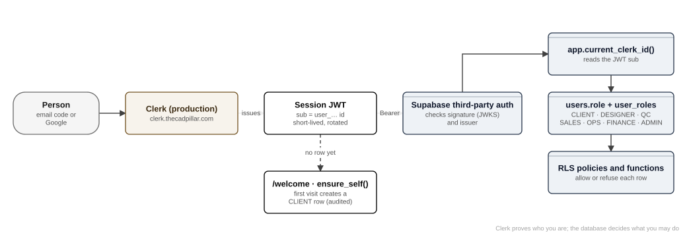

# Authentication, authorisation and the role matrix

**Authentication** answers "who are you?" and is handled by Clerk. **Authorisation** answers "what may you do?" and is handled by the database. This chapter covers both, the bridge between them, how roles are granted, and the full capability matrix.

## Authentication (Clerk)

| Item | Setting (13 November 2026) |
|---|---|
| Instance | **Production**, on `clerk.thecadpillar.com` (DNS CNAMEs in Vercel DNS). The development instance remains for CI and browser tests only. |
| Sign-in methods | Email verification code; Google (custom OAuth credentials owned by the company); password via "Forgot password" for accounts that set one |
| Session | Clerk session cookie on `thecadpillar.com`; short-lived session token (JWT) refreshed by Clerk |
| Keys | `NEXT_PUBLIC_CLERK_PUBLISHABLE_KEY` (public), `CLERK_SECRET_KEY` (server only), `CLERK_JWT_ISSUER` = `https://clerk.thecadpillar.com`. Preview deployments use the development keys. |
| Pages | `/sign-in`, `/sign-up` (`app/(auth)`), wrapped in `components/auth` |
| Passwords stored by TCP | None |

### Middleware

`middleware.ts` wraps Clerk's middleware with three rules from `core/auth/session.ts`:

1. `skipsClerk(method, path)`: a GET or HEAD of a public website page (`PUBLIC_WEBSITE_PAGES`), or of a path outside every app segment (`APP_ROUTE_SEGMENTS`), skips Clerk entirely. Search engines get a clean 200 or 404, and the 404 page renders. Form posts always go through Clerk.
2. `isProtectedPath(path)`: paths under `PROTECTED_PREFIXES` (`/home`, `/welcome`, `/messages`, `/wallet`, `/files`, `/dashboard`, `/orders`, `/account`, `/admin`, `/settings`, `/onboarding`, `/work`, `/qc`, `/pod`) call `auth.protect()`. A signed-out browser is redirected to `/sign-in`.
3. A first-touch marketing cookie (HTTP-only, SameSite=Lax, Secure in production) records where a visitor first came from.

`/api/webhooks/razorpay` is deliberately not protected: Razorpay carries no session, so its security is the HMAC signature. The middleware is the first layer only. Every page, action and handler checks again.

## The identity bridge (Clerk to Supabase)

1. The server asks Clerk for the current session token (`auth().getToken()`).
2. `createUserSupabaseClient()` sends it as `Authorization: Bearer …`, alongside the public anon key.
3. Supabase's **third-party auth** integration (configured with Clerk's domain) verifies the signature against Clerk's published keys (JWKS) and checks the issuer.
4. In SQL, `app.current_clerk_id()` returns the token's `sub`. Every policy and function uses it.
5. On a first visit, `/welcome` calls `ensure_self()`. That creates a `users` row with role `CLIENT` and writes an audit entry. Staff and designers are created by admins instead (see below).

If the Supabase third-party auth domain does not match the Clerk instance that issued the token, every signed-in read returns nothing. This is the first thing to check after any Clerk change (`docs/LAUNCH.md`, `docs/CLERK-PRODUCTION.md`).

## Authorisation model

- **Roles** (`role` enum): `CLIENT`, `DESIGNER`, `QC` (pod lead), `SALES`, `OPS`, `FINANCE`, `ADMIN`, `SUPER_ADMIN`. `users.role` holds one primary role; `user_roles` adds staff roles.
- **Admin** in the business sense means Sales + Ops + Finance (`app.is_admin()`). Some admin-only actions check all three explicitly (for example `sendTestEmailsAction`).
- **Scope.** A pod lead's reach is their pods (`app.current_pod_ids()`, `app.order_in_my_pods()`). A designer's reach is jobs assigned to them (`app.is_assigned_designer()`, `my_work()`). A client's reach is their own orders and their client account.
- **Enforcement.** Row-level security plus SECURITY DEFINER functions (chapter 5). UI gates such as `requireTeam`, `requireAdmin`, `requireFinance` and role-based navigation are conveniences, not controls.

### How roles are granted

| Who | How | Function |
|---|---|---|
| Client | Self sign-up (`/welcome` → `ensure_self`), or an admin or pod lead registers them while placing an order on their behalf | `ensure_self`, `register_client` |
| Designer | An admin adds them by "email - Name" on Admin → Designers. They sign in with an emailed code, apply in-app, sign the agreement, and become `ACTIVE`. | `register_designer`, `apply_as_designer`, `accept_designer_agreement` |
| Pod lead | An admin sets the role to pod lead on Admin → Access. That creates the lead's pod ("Masud's pod"). Designers are placed in pods. | `set_user_role`, `create_pod`, `set_pod_member`, `remove_pod_member` |
| Admin, Sales, Ops, Finance | An admin grants the role on Admin → Access | `set_user_role` |
| Suspension | An admin sets the user's status (typing `suspend` to confirm) | `set_user_status` |

Every grant, status change and identity lookup is written to the audit log (`record_identity_lookup` for admin reads of names).

## Role and capability matrix

Legend: ✔ allowed · ◐ limited (see note) · ✖ refused by the database.

| Capability | Client | Designer | Pod lead (QC) | Admin (Sales/Ops/Finance) |
|---|---|---|---|---|
| Create and submit an order, write the brief | ✔ own | ✖ | ◐ on behalf of a client | ✔ on behalf of a client |
| See the order's price and payments | ✔ own | ✖ | ✖ (1.25) | ✔ |
| Quote an order | ✖ | ✖ | ✖ | ✔ (Sales) |
| Pay (card or UPI) | ✔ own | ✖ | ✖ | ◐ records manual payments |
| Confirm the order and choose its pod | ✖ | ✖ | ◐ confirm in own pod | ✔ |
| Assign or move a job to a designer | ✖ | ✖ | ✔ own pod (reason once started) | ◐ folded exception |
| See the brief and references | ✔ own | ✔ assigned jobs (no client identity) | ✔ own pod | ✔ |
| Upload deliverables (3DM, STL, render, technical sheet) | ✖ | ✔ assigned job | ◐ | ◐ |
| Designer self-check (9 lines) | ✖ | ✔ | ✖ | ✖ |
| QC decision (pass or send back) | ✖ | ✖ (never on own work) | ✔ own pod | ✔ |
| Approve, request a revision or dispute | ✔ own | ✖ | ✖ | ✖ |
| Download final files | ◐ after approval | ✔ own versions | ✔ own pod | ✔ |
| Message the client thread | ✔ ("Your team") | ✖ never | ✔ | ✔ |
| Message the internal thread | ✖ | ✔ | ✔ | ✔ |
| Forward a message between client and designer | ✖ | ✖ | ✔ | ✔ |
| See own pay per job | ✖ | ✔ | ✔ designer and pod pay | ✔ |
| See or change a designer's rate | ✖ | ✖ | ◐ see only | ✔ |
| See identities (names, emails, companies) | ✖ | ✖ | ◐ first names of staff | ✔ (logged) |
| See or edit bank details and identity documents | ✖ | ◐ own last four digits | ✖ | ✔ (every view logged) |
| Release payouts and refunds | ✖ | ✖ | ✖ | ✔ (Finance) |
| Decide SLA credits | ✖ | ✖ | ✖ | ✔ |
| Settings, feature flags, emails | ✖ | ✖ | ✖ | ✔ |
| Create preview links for the client's customer | ✔ own | ✖ | ✖ | ✔ |
| Pod materials | ✖ | ✔ read own pod | ✔ add and remove in own pod | ✔ |
| Calculators (`/tools`) | ✖ | ✔ | ✔ | ✔ |

The matrix follows DECISIONS §2, §5, §10, §11 and §14. Where a cell says ✖, the refusal is enforced in the database.

## Security properties worth knowing

- **No identity leaves the wall through the UI or the API.** The browser test `tests/e2e/anonymity.e2e.ts` crawls every client and designer screen and fails on any counterparty name or email.
- **Sessions are not trusted for roles.** The role is read from the database on every request, so removing a role takes effect on the next request; nobody has to sign out.
- **Server actions** are protected by Next.js's Origin check. `NEXT_SERVER_ACTION_ALLOWED_ORIGINS` lists any extra allowed origins.
- **Sign-out** reloads the page so nothing is kept in the browser's router cache for the next person on the device (`components/auth/sign-out`).
