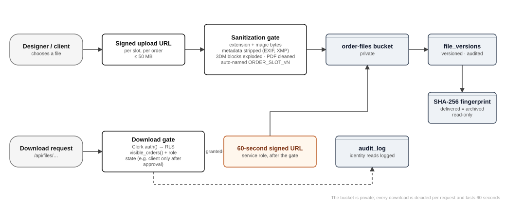

# File storage and CAD intellectual-property protection

CAD files are the product. They are the client's confidential designs and the designer's work, and the escrow model depends on nobody receiving final files before approval. This chapter describes where files live, how they enter, how they are cleaned, who may take them out and when, and how deliveries are proven unchanged.

## Where files live

| Bucket (Supabase Storage) | Visibility | Contents | Configured in |
|---|---|---|---|
| `order-files` | Private | Deliverables (3DM, STL, render, technical sheet), reference images, stone certificates, screenshots, chat attachments, certificates, client logos, pod materials | `config/supabase.ts` (`ORDER_FILES_BUCKET`) |
| `designer-application-files` | Private | Portfolio files sent with public designer applications | `DESIGNER_APPLICATION_FILES_BUCKET` |
| `designer-documents` | Private | PAN card, masked Aadhaar, bank proof (admins only) | `DESIGNER_DOCUMENTS_BUCKET`, created by `0061_designers_by_team.sql` |

No bucket is public. There is no stable web address for any file. The browser never receives the service-role key. Object keys are opaque. Delivered files are renamed `{ORDER}_{SLOT}_v{n}.{ext}` (DECISIONS §9), so original filenames, which often name the studio, never travel.

## The way in

1. **Choose a slot.** Required deliverable slots: `3DM`, `STL`, `RENDER` and `TECH` (DECISIONS §9; older ten-view slots stay readable on old versions). Accepted types per slot are listed in `core/files/slotTypes.ts`. Images are PNG or JPEG only; PDF is accepted only where a document is expected, such as stone certificates.
2. **Signed upload URL.** The server checks the caller may upload to this order and slot (`my_work`, `job_slots`). It then mints a single-use signed upload URL (`createSignedUploadUrl`), so large files go straight to storage without passing through a serverless function. Deliverables may be up to **50 MB** (`MAX_DELIVERABLE_BYTES`); other uploads go through the general gate at **25 MiB** (`MAX_UPLOAD_BYTES`).
3. **Sanitization gate** (`core/files/sanitizationGate.ts`), a pure function covered by unit tests:
   - the extension must be allowed for the slot;
   - the size must be within the limit;
   - **the magic bytes must match the declared type**: PNG `89 50 4E 47`, JPEG `FF D8 FF`, PDF `%PDF`, STEP `ISO-10303-21`, 3DM header; STL is recognised by its exact binary length or its ASCII form;
   - the object is renamed to an opaque key.
4. **Metadata stripping** (`core/files/metadataStripper.ts`). The container is rebuilt from its structural parts, keeping an **allow-list** of what is needed to render or manufacture. Anything unknown is dropped by default. That covers JPEG EXIF (camera, GPS, author), PNG text and time chunks (`tEXt`, `iTXt`, `zTXt`, `eXIf`, `tIME`), and STEP header author and organisation fields.
5. **Format-specific cleaners:**
   - **3DM** (`lib/files/strip3dm.ts`, rhino3dm): the model is *rebuilt*. A new model receives only units, tolerances, layers (name and colour) and geometry. Creator, last editor, application and licence, notes, comments, object names, user text and plug-in data are left behind by construction. **Blocks are exploded** into geometry, so block names cannot leak.
   - **PDF** (`lib/files/cleanPdf.ts`, pdf-lib): only the pages are kept. Document info, XMP, comments, attachments, scripts and earlier revisions are removed (DECISIONS 1.14).
   - **Images** passed to `sharp` (render composition, technical-sheet panels) have already passed the signature check, so only verified PNG and JPEG reach the image decoder.
6. **Record the version.** `add_slot_file` / `add_file_version` writes a `file_versions` row (versioned, audited, uploader party recorded by trigger `app.set_uploader_party`).

## The way out

Every download is decided per request (`lib/files/access.ts`):

1. Clerk `auth()`: no session gives 401.
2. Read the `file_versions` row with the **user-scoped client**. If RLS hides it, the response is 404.
3. Read the order through `visible_orders()`. It returns nothing for orders the caller cannot see, plus the caller's *relation* to the order (client, designer, staff).
4. `fileGrantFor()` (`core/files/downloadGate.ts`) decides **which artefact** this relation may receive in this order state. The rule the escrow model rests on: **before approval, the client sees the four render views, the gold weight chart and the diamond details only. Approval releases the STL, the 3DM and the summary sheet.** There is no "degraded model" before approval, because there is no model at all.
5. Only then does the server mint a **60-second** signed URL with the service role, and redirect.

Other file families follow the same pattern through dedicated functions: `thread_file_for_download`, `pod_material_file`, `designer_document_open` (admins only, audited), `certificate_for_download` and RLS on `order_reference_images`.

## Proof of delivery and the spec guarantee

- **Fingerprints.** Delivered files are hashed with SHA-256 and archived read-only (DECISIONS §9). The QC certificate (`certificates`, immutable by trigger) records the fingerprints. It doubles as the signed spec sheet: minimum wall, prong and stone-seat sizes, ring size, mesh tolerance, no open edges.
- **Spec claims.** If a delivered file breaks its own spec sheet, TCP fixes it free and refunds the CAD fee. A claim on a file whose fingerprint no longer matches (an edited file) is excluded, as are casting failures where the archived file meets spec, recorded client waivers, and claims after 30 days (DECISIONS §7; tables `spec_claims`, `spec_waivers`).
- **Preview links** (`/p/[token]`). A client can send their own customer a branded 3D view built from the STL, with renders alongside. The token is 192 bits from `randomBytes(24)` and is stored only as a hash. Links expire, can be revoked and count views. The page never shows the designer, TCP's client, the price or any download.

## Identity documents (designer compliance)

- Entered and seen by **admins only**, never pod leads or other designers (DECISIONS §14).
- Aadhaar is kept as the **masked** copy (last four digits).
- Full bank details are shown only on request (`payout_account_full`), and **every full view and every document open is written to the audit log**.
- Removing a document deletes its stored file.

## Threats considered

| Threat | Control |
|---|---|
| Client downloads final files before approval or payment | Download gate by artefact and state; RLS; 60-second links |
| Designer learns the client's identity from a file | Metadata stripping, 3DM rebuild, opaque names, chat role labels |
| Client learns the designer's studio from a file | As above; STEP and PDF author fields removed |
| Malicious file disguised as an image or model | Magic-byte checks; type allow-lists per slot; size caps; images re-encoded |
| Leaked link reused later | Signed URLs live 60 seconds; preview tokens expire and can be revoked |
| Bulk scraping of the bucket | Private buckets; no listing for clients; keys are opaque |
| Edited file blamed on TCP | SHA-256 fingerprints on the certificate; fingerprint mismatch excludes the claim |
| Insider over-reading identity documents | Admins only; every view audited in a hash-chained log |

Residual risks (dependency advisories in the image libraries, upload abuse by self-registered accounts) are in the security register, chapter 9.
